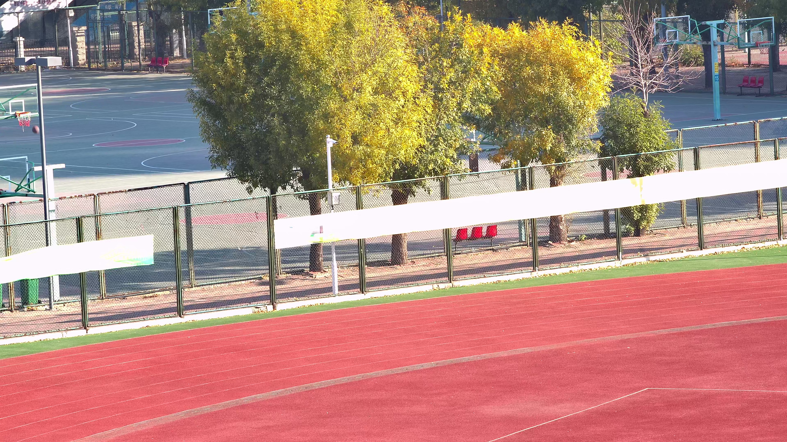
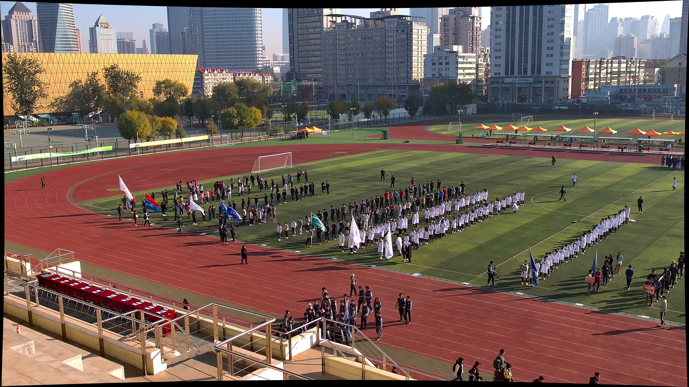

# image_stitch

来自原工程 `image_stitching` 的跨视角图像拼接项目。仓库按算法分为三块；目前前两块有代码、真实输入和可复现输出，视频背景去除留待后续整理。

| 模块 | 用途 | 可运行样例 |
| --- | --- | --- |
| [`image_stitch`](docs/image_stitch.md) | OmniGlue 点匹配 + LineTR 线匹配，估计/精修单应性、HHM 色差矫正并羽化拼接 | 运动场、展厅、校园道路各一组图像 |
| [`three_region_stitch`](docs/three_region_stitch.md) | 双视角视频运动掩膜 + 点线运动区单应性 + RAFT 静态区 + Global 背景合图 | 商街人群双视角 200 帧短视频 |
| `video_background_removal` | 视频背景去除 | 后续加入 |

## 1. 纯点线单应性拼接

输入是 Local 和 Global 两张图像，可选相机标定初值 `H_init`。输出 `H_final`、投影和羽化融合图；融合前根据重叠区域估计 HHM 色彩映射，校正 Local 与 Global 的颜色差异。三个不同场景的输入、初值局部放大、点线匹配及最终输出见[纯拼接样例说明](docs/image_stitch.md)。

| Local 输入 | Global 输入 |
| --- | --- |
|  |  |

## 2. 运动感知三分区域拼接

### 算法流程

**动机：**

该方法主要处理不同景深的前景与背景在跨视角拼接时产生的视差错位。例如，树木、路灯杆等近景结构与远处地面背景的投影关系不同，单个全局单应性难以同时对齐两者，而人或车运动的区域一般认为是地面（背景部分），地面以上非运动的部分认为是景深较浅的前景部分，因此分区域进行拼接。

**方法：**

Local 和 Global 短视频生成的运动掩膜用于辅助划分融合区域，两侧都检测到运动的重叠区域，通过点线匹配精修单应性后投影 Local；其他有效的 Local 重叠区域由 RAFT 光流对齐；其余部分使用 x6 处理后的 Global 背景。合成前从红、蓝两区共同采样，估计一套 HHM 色彩映射并同时校正两路 Local 来源。

**输入与输出：**

输入包括同步的 Local/Global 图像、相机标定得到的初始单应矩阵 `H_init`，以及两路相机对应的视频片段。

1. **建立几何初值**：用 `H_init` 把 Local 映射到 Global 坐标系，作为两视角对齐的起点。
2. **提取运动线索并精修单应性**：分别从两路视频生成运动掩膜。点线匹配只采用两侧都检测到运动的对应，用于精修 `H_init`，得到投影 Local 的单应性。
3. **统一掩膜和投影坐标**：把 Local 运动掩膜按精修后的变换更新到 Global 坐标，并计算 Local 投影的有效范围。这样就能在同一张 Global 画布上比较两侧的运动区域和 Local 有效区域。
4. **按像素来源划分三区**：

   | 区域 | 归属规则 | 使用的图像 |
   | --- | --- | --- |
   | 红色：运动区单应性 | 两侧都检测到运动，且 Local 投影有效 | 单应性投影后的 Local |
   | 蓝色：RAFT 区 | 其他有效 Local 区域中，通过 RAFT 前后向一致性检查的部分；默认包含只有一侧检测到运动的区域 | RAFT 对齐后的 Local |
   | 绿色：Global 背景区 | 剩余区域，包括 Local 投影无效或 RAFT 检查失败的位置 | x6 处理后的 Global 背景 |

   三个区域互不重叠，并覆盖整张 Global 画布。运动掩膜标记的是视频中随时间发生变化的位置，不是前景/背景语义标签。它帮助选择融合路径；树木、路灯杆等静止近景如果产生局部视差，会由 RAFT 区尝试对齐，RAFT 不可靠时则使用 Global 背景。
5. **校正颜色并合成高分辨率结果**：将 Global 画布整体输出为 x6（Lanczos 插值 1.5 倍后执行 FSRCNN x4），并从红、蓝区域分别抽取与 Global 对齐的像素对，共同估计一套 HHM 映射；同一映射应用于单应性区和 RAFT 区，避免两区颜色不一致。纯点线单应性结果也根据其 Local/Global 重叠像素单独估计 HHM 映射。之后将原始 Local 内容合入 x6 画布，RAFT 光流位移和区域掩膜同步映射到高分辨率画布；仅在三区边界附近羽化，默认半径为原画布 6 px，即 x6 输出中的 36 px。

当前展示这一组商街样例。Local 输入保留相机原始的 3840 × 2160 分辨率；Local/Global 输入、200 帧 ROI 视频、缓存的掩膜/RAFT 中间结果、最终图和同一局部 ROI 对照均在仓库中。视频是真实相机帧，不是合成运动。详见[三分区域算法、数据与复现](docs/three_region_stitch.md)。

### 商街人群 · `20220806141041707_cam11`

#### 输入图像

| Local 输入 | Global 输入 |
| --- | --- |
|  |  |

两图是同步的 Frame 6000 输入：Local 为相机原始全幅（3840 × 2160），Global 为去畸变并裁剪后的输入（1070 × 786）。

#### 区域归属与最终融合

| 三区归属图 | 最终融合结果 |
| --- | --- |
|  |  |

左图叠加在 x6 Global 背景上，以硬掩膜颜色显示归属：红色为 Local 与 Global 双运动掩膜交集内且 Local 投影有效的单应性区，蓝色为红区外通过 RAFT 前后向一致性检查的 Local 区域，绿色由 Global 保留。右图以相同的 x6 Global 为背景合入 Local 内容。红、蓝区域共同估计一套 HHM 色彩映射，并应用到两路 Local 来源；区域交界处再做高斯羽化（原画布半径 6 px，放大后 36 px）。x6 Global 由 1.5 倍 Lanczos 插值和 FSRCNN x4 两步生成；Local 投影直接使用原始图像，避免先低分辨率融合再放大。

#### Local 区域近 4K 拼接对照

| 纯点线单应性拼接 | 三分区域融合 |
| --- | --- |
| [](examples/three_region_stitch/20220806141041707_cam11/output/three_region/pure_stitch_local_roi_fsrcnn_x6.jpg) | [](examples/three_region_stitch/20220806141041707_cam11/output/three_region/final_result_local_roi_fsrcnn_x6.jpg) |

左图是纯点线单应性拼接结果，右图是三分区域融合结果。两图均从完整 x6 结果中按 Local 投影范围加 24 px 原画布留白后裁出，尺寸一致，为 **4080 × 2352**。

#### 全 ROI 误差热图

| 纯点线单应性拼接 | 三分区域融合 |
| --- | --- |
|  |  |

两张图分别显示对应 x6 拼接结果相对 x6 Global 背景的平均 RGB 绝对差，颜色由蓝到红表示误差由小到大；图片独立保存，不带标题框。

## 快速运行

Python 3.10–3.12 环境下，安装并运行缓存样例：

```bash
git clone --recursive https://github.com/liuyuxiang1021/image_stitch.git
cd image_stitch
python -m pip install -e .
three-region-stitch --example examples/three_region_stitch/20220806141041707_cam11
```

默认使用缓存的运动掩膜、单应性和 RAFT 结果，生成 x6 融合图（Lanczos ×1.5，再用 FSRCNN ×4）。输出位于样例的 `output/three_region/`：

- `final_result.jpg`：原分辨率诊断图。
- `final_result_global_fsrcnn_x6.jpg`：完整画布融合结果。
- `final_result_local_roi_fsrcnn_x6.jpg`：Local 附近的近 4K 结果。
- `region_overlay_*.jpg`：三区归属图；`pure_stitch_local_roi_fsrcnn_x6.jpg`：纯点线对照图。

完整重算和纯拼接命令见[三分区域文档](docs/three_region_stitch.md)与[纯拼接文档](docs/image_stitch.md)。

## 同场景小规模评测

对五组入选的场景/相机样例，使用对应帧和 `H_init` 分别运行纯 OmniGlue + LineTR、OpenCV SIFT + RANSAC，以及三分区域融合。样例为 `20210112134325996/cam15`、`20220806141041707/cam11`、`20220806141041707/cam21`、`20220806141041707/cam31` 和 `20250704164617116/cam15`。全 ROI 评测将三种 x6 结果与同一 x6 Global 背景比较，范围为 Local 投影区域外扩 24 px 原画布留白后的完整区域；三种结果统一使用原画布半径 6 px 的边缘羽化。表中数值是五组样例逐组计算后的等权算术平均。

| 指标 | SIFT + RANSAC | 纯点线（OmniGlue + LineTR） | 三分区域融合 |
| --- | ---: | ---: | ---: |
| PSNR（dB） | 20.247 | 20.207 | **21.911** |
| SSIM | 0.6822 | 0.6734 | **0.7053** |

这些数值表示结果与 x6 Global 背景的相似程度，不是有真值的拼接质量分数。三分区域结果中由 Global 保留的像素与参照相同，因此会影响全 ROI 得分。

## 仓库结构

```text
src/image_stitch/                # 纯点线单应性、HHM 色差矫正与羽化融合
src/three_region_stitch/         # 双运动掩膜、运动区 H、RAFT、共享 HHM 与三区合图
examples/image_stitch/           # 三组静态图像输入与输出
examples/three_region_stitch/    # 三组双视角视频输入与输出
docs/                            # 算法、数据、评测及运行细节
third_party/                     # 官方 OmniGlue、LineTR、RAFT Git submodules
scripts/                         # 模型准备、样例导出、评测
```

`video_background_removal` 目前没有实现或样例，后续再加入。LineTR 的许可证限制为学术或非营利机构的非商业研究用途，使用前请阅读 [`third_party/LineTR/LICENSE`](third_party/LineTR/LICENSE)。
