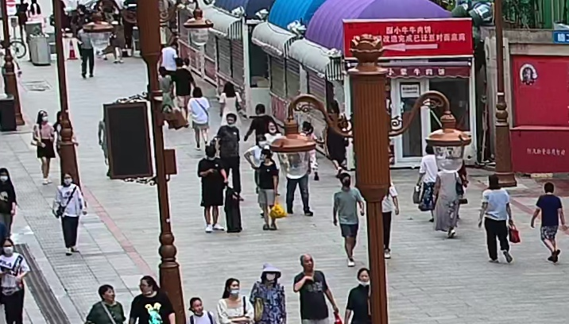
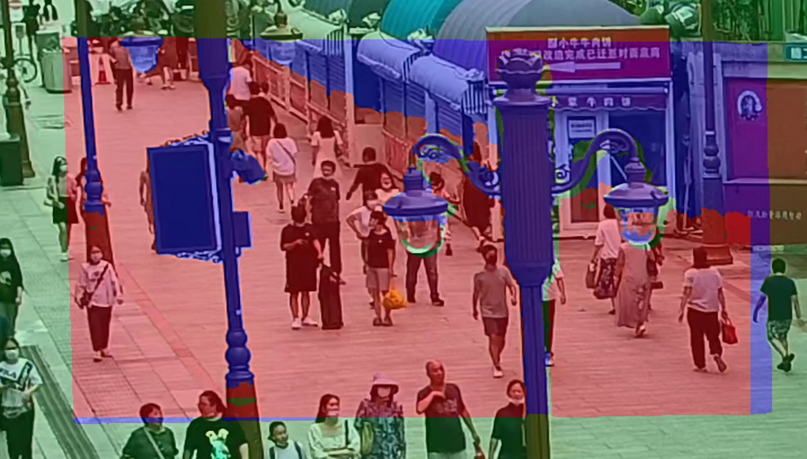
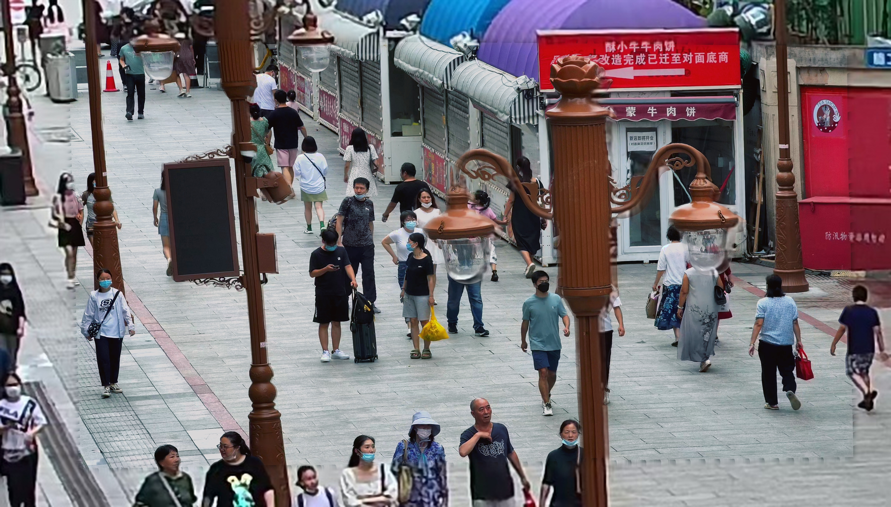
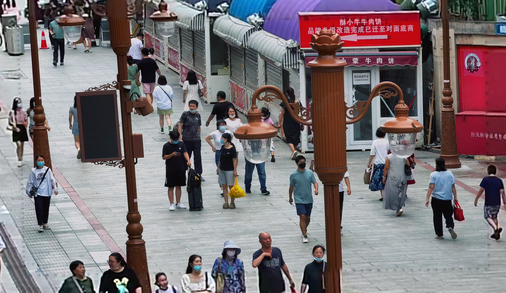
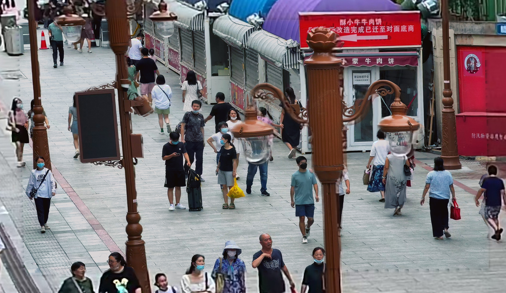

# image_stitch

来自原工程 `image_stitching` 的跨视角图像拼接项目。仓库按算法分为三块；目前前两块有代码、真实输入和可复现输出，视频背景去除留待后续整理。

| 模块 | 用途 | 可运行样例 |
| --- | --- | --- |
| [`point_line_stitch`](docs/point_line_stitch.md) | OmniGlue 点匹配 + LineTR 线匹配，估计/精修单应性、HHM 色差矫正并羽化拼接 | 运动场两组、展厅、校园道路、商街各一组图像 |
| [`three_region_stitch`](docs/three_region_stitch.md) | 双视角视频运动掩膜 + 点线运动区单应性 + RAFT 静态区 + Global 背景合图 | 五组双视角样例，各含 1000 帧 ROI 视频 |
| `video_background_removal` | 视频背景去除 | 后续加入 |

双视角样例以 Global 帧为基准搜索对应的 Local 帧；逐帧评分和选择结果见[帧配对说明](docs/frame_synchronization.md)。

## 1. 纯点线单应性拼接

### 算法流程

输入 Local 和 Global 两张图像，可选标定初值 `H_init`；输出单应矩阵 `H_final` 和融合图。

1. 用 `H_init` 将 Local 投影到 Global，确定重叠区域；没有初值时直接从两张图像估计。
2. 用 OmniGlue 匹配点、LineTR 匹配线，过滤不可靠的匹配后共同优化，得到 `H_final`。
3. 根据重叠区域校正 Local 颜色，将原始 Local 投到放大后的局部画布，并在边缘羽化（原画布半径 6 px）。Global 局部背景使用 Lanczos 插值放大 6 倍。

纯拼接和三分区域中的纯单应性对照共用投影、HHM 校色与羽化代码；三分区域的 Global 背景另由 FSRCNN 生成。

下面展示运动场 `20201024084037322_cam11` 样例；其余四组的初值定位、点线匹配和最终输出见[纯拼接样例说明](docs/point_line_stitch.md)。

### 输入图像

| Local 输入 | Global 输入 |
| --- | --- |
|  |  |

### 最终拼接结果

两图为 Local 投影附近的同一范围（4074 × 2388）。左图是插值放大的 Global 背景，右图是保留原始 Local 细节的拼接结果。

| Global 局部背景 | 纯点线单应性拼接 |
| --- | --- |
|  |  |

### 五组纯点线样例评测

这五组以单个单应性拼接。SIFT + OpenCV RANSAC 基线与 OmniGlue + LineTR 点线方法使用相同的 `H_init`、Local ROI、Lanczos x6 Global 背景、HHM 校色和 6 px 边缘羽化。两种结果与同一 Global ROI 比较；表中为五组均值，逐组数据见[纯点线评测数据](examples/point_line_stitch/metrics.json)。

| 指标 | SIFT + OpenCV RANSAC | 纯点线（OmniGlue + LineTR） |
| :---: | :---: | :---: |
| PSNR（dB） | 22.754 | 22.734 |
| SSIM | 0.6510 | 0.6515 |

## 2. 运动感知三分区域拼接

### 算法流程

**动机：**

该方法主要处理不同景深的前景与背景在跨视角拼接时产生的视差错位。例如，树木、路灯杆等近景结构与远处地面背景的投影关系不同，单个全局单应性难以同时对齐两者，而人或车运动的区域一般认为是地面（背景部分），地面以上非运动的部分认为是景深较浅的前景部分，因此分区域进行拼接。

**输入与输出：**

输入包括配对后的 Local/Global 图像、相机标定得到的初始单应矩阵 `H_init`，以及两路相机对应的视频片段。

**方法：**

Local 和 Global 短视频生成的运动掩膜用于辅助划分融合区域，两侧都检测到运动的重叠区域，通过点线匹配精修单应性后投影 Local；其他有效的 Local 重叠区域由 RAFT 光流对齐；其余部分使用 x6 处理后的 Global 背景。合成前从红、蓝两区共同采样，估计一套 HHM 色彩映射并同时校正两路 Local 来源。

1. **建立几何初值**：用 `H_init` 把 Local 映射到 Global 坐标系，作为两视角对齐的起点。
2. **提取运动线索并精修单应性**：分别从两路视频生成运动掩膜。点线匹配只采用两侧都检测到运动的对应，用于精修 `H_init`，得到投影 Local 的单应性。
3. **统一掩膜和投影坐标**：把 Local 运动掩膜按精修后的变换更新到 Global 坐标，并计算 Local 投影的有效范围。这样就能在同一张 Global 画布上比较两侧的运动区域和 Local 有效区域。
4. **按像素来源划分三区**：

   | 区域 | 归属规则 | 使用的图像 |
   | --- | --- | --- |
   | 红色：运动区单应性 | 两侧都检测到运动，且 Local 投影有效 | 单应性投影后的 Local |
   | 蓝色：RAFT 区 | 其他有效 Local 区域中，通过 RAFT 前后向一致性检查的部分；默认包含只有一侧检测到运动的区域 | RAFT 对齐后的 Local |
   | 绿色：Global 背景区 | 剩余区域，包括 Local 投影无效或 RAFT 检查失败的位置 | x6 处理后的 Global 背景 |

   三个区域互不重叠，并覆盖整张 Global 画布。运动掩膜标记的是视频中随时间发生变化的位置，不是前景/背景语义标签。它帮助选择融合路径；树木、路灯杆等静止近景如果产生局部视差，会由 RAFT 区尝试对齐，RAFT 不可靠时则使用 Global 背景。
5. **校正颜色并合成高分辨率结果**：Global 先放大 1.5 倍，再用 FSRCNN x4 生成 x6 背景。红、蓝两区共用一套 HHM 颜色校正；纯点线结果单独校正。最后将 Local 内容合入 x6 画布，并在区域边界羽化，半径为原画布 6 px。

下面展示商街 `20220806141041707_cam11` 样例。输入、1000 帧 ROI 视频和算法缓存分别放在 `input/` 与 `cache/`；其余四组见[三分区域样例说明](docs/three_region_stitch.md)。

### 输入图像

Global 取 Frame 6000，Local 配对到 Frame 5997；Local 为 3840 × 2160 原始图，Global 为去畸变后的 716 × 408 裁剪图。

| Local 输入 | Global 输入 |
| --- | --- |
|  |  |

### 区域归属与最终融合

两图展示同一张 x6 Global 画布（4296 × 2448）：左图用颜色标出三区归属，右图是融合结果。

| 三区归属图 | x6 最终融合 |
| --- | --- |
|  |  |

### Local 区域近 4K 拼接对照

两图取自相同的 Local 投影区域，尺寸均为 4080 × 2364。

| 纯点线单应性拼接 | 三分区域融合 |
| --- | --- |
|  |  |

### 五组三分区域样例评测

对五组入选样例比较 SIFT + OpenCV RANSAC、纯点线拼接与三分区域融合。SIFT 基线使用 `cv.findHomography` 求 H；纯点线方法先用 OpenCV RANSAC 求点匹配初值，再用本项目的点线联合优化精修 H。三者使用相同的 x6 Global 背景、HHM 校色和羽化。评测区域是各组 Local 投影范围外扩 24 px 后的局部，参照为同一区域的 x6 Global 背景；表中是五组结果的算术平均，逐组结果见[三分区域评测数据](examples/three_region_stitch/selected_1000f/metrics.json)。

| 指标 | SIFT + OpenCV RANSAC | 纯点线（OmniGlue + LineTR） | 三分区域融合 |
| :---: | :---: | :---: | :---: |
| PSNR（dB） | 20.469 | 20.626 | **23.043** |
| SSIM | 0.6767 | 0.6834 | **0.7172** |

## 快速运行

Python 3.10–3.12 环境下，安装并运行缓存样例：

```bash
git clone --recursive https://github.com/liuyuxiang1021/image_stitch.git
cd image_stitch
python -m pip install -e .
three-region-stitch --example examples/three_region_stitch/selected_1000f/20220806141041707_cam11
```

默认读取 `cache/` 中的运动掩膜、单应性和 RAFT 结果，生成 x6 融合图（Lanczos ×1.5，再用 FSRCNN ×4）。输出位于样例的 `output/three_region/`：

- `final_result.jpg`：原分辨率诊断图。
- `final_result_global_fsrcnn_x6.jpg`：完整画布融合结果。
- `final_result_local_roi_fsrcnn_x6.jpg`：Local 附近的近 4K 结果。
- `region_overlay_*.jpg`：三区归属图；`pure_stitch_local_roi_fsrcnn_x6.jpg`：纯点线对照图。

完整重算和纯拼接命令见[三分区域文档](docs/three_region_stitch.md)与[纯拼接文档](docs/point_line_stitch.md)。

## 仓库结构

```text
src/point_line_stitch/                # 纯点线单应性、HHM 色差矫正与羽化融合
src/three_region_stitch/         # 双运动掩膜、运动区 H、RAFT、共享 HHM 与三区合图
examples/point_line_stitch/           # 五组静态图像输入与输出
examples/three_region_stitch/    # 五组 1000 帧入选样例及三组旧版样例
docs/                            # 算法、数据、评测及运行细节
third_party/                     # 官方 OmniGlue、LineTR、RAFT Git submodules
scripts/                         # 模型准备、样例导出、评测
```

`video_background_removal` 目前没有实现或样例，后续再加入。LineTR 的许可证限制为学术或非营利机构的非商业研究用途，使用前请阅读 [`third_party/LineTR/LICENSE`](third_party/LineTR/LICENSE)。
