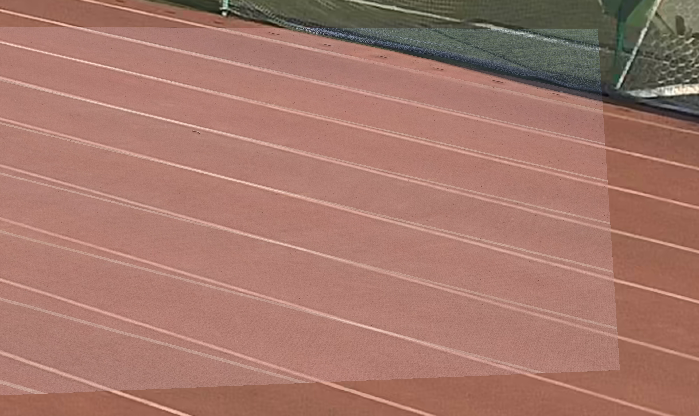

# image_stitch

来自原工程 `image_stitching` 和 `MotionMask` 的图像处理项目，按算法分为三块。每块都有代码、真实输入和可复现输出。

| 模块 | 用途 | 可运行样例 |
| --- | --- | --- |
| [`point_line_stitch`](docs/point_line_stitch.md) | OmniGlue 点匹配 + LineTR 线匹配，估计/精修单应性、HHM 色差矫正并羽化拼接 | 运动场两组、展厅、校园道路、商街各一组图像 |
| [`three_region_stitch`](docs/three_region_stitch.md) | 双视角视频运动掩膜 + 点线运动区单应性 + RAFT 静态区 + Global 背景合图 | 五组双视角样例，各含 1000 帧 ROI 视频 |
| [`video_background_removal`](docs/video_background_removal.md) | 从固定机位视频提取灰度静态背景与静态区域掩码 | 商街 Global 相机 1000 帧局部视频 |

双视角样例以 Global 帧为基准搜索对应的 Local 帧；逐帧评分和选择结果见[帧配对说明](docs/frame_synchronization.md)。

## 1. 纯点线单应性拼接

### 算法流程

输入 Local 和 Global 两张图像，可选标定初值 `H_init`；输出单应矩阵 `H_final` 和融合图。

1. 用 `H_init` 将 Local 投影到 Global，确定重叠区域；没有初值时直接从两张图像估计。
2. 用 OmniGlue 匹配点、LineTR 匹配线，过滤不可靠的匹配后共同优化，得到 `H_final`。
3. 根据重叠区域校正 Local 颜色，将原始 Local 投到放大后的局部画布，并在边缘羽化（原画布半径 6 px）。Global 局部背景使用 Lanczos 插值放大 6 倍。

纯拼接和三分区域中的纯单应性对照共用投影、HHM 校色与羽化代码；三分区域的 Global 背景另由 FSRCNN 生成。

下面展示运动场 `20201024084037322_cam11` 样例；其余四组的初值定位、点线匹配和最终输出见[纯拼接样例说明](docs/point_line_stitch.md)。

### 输入图像

| Local 输入 | Global 输入 |
| --- | --- |
|  |  |

### 最终拼接结果

两图为 Local 投影附近的同一范围（4074 × 2388）。左图是插值放大的 Global 背景，右图是保留原始 Local 细节的拼接结果。

| Global 局部背景 | 纯点线单应性拼接 |
| --- | --- |
|  |  |

### SIFT + RANSAC 定性对照

以下均为 Frame 6000 的同一 Local ROI，以 Local/Global 50:50 原始叠加显示；未做色差校正或羽化，便于观察几何对齐。这里只展示代表性画面，不给出综合性能分数。

#### 运动场 · `20201025083303988/cam34`

Frame 6000 · ROI 4008 × 2388。

| SIFT + OpenCV RANSAC | OmniGlue + LineTR 点线 |
| --- | --- |
|  |  |

#### 场景 `20260109122648396/cam22`

Frame 6000 · ROI 4032 × 2352。

| SIFT + OpenCV RANSAC | OmniGlue + LineTR 点线 |
| --- | --- |
|  |  |

另有 SIFT 未能估计出有效单应矩阵的案例：`20260109122648396/cam34` 中 RANSAC 失败，因此没有对应的 SIFT 拼接图或成对画质分数。下图只展示点线结果，作为失败案例说明。



## 2. 运动感知三分区域拼接

### 算法流程

**动机：**

该方法主要处理不同景深的前景与背景在跨视角拼接时产生的视差错位。例如，树木、路灯杆等近景结构与远处地面背景的投影关系不同，单个全局单应性难以同时对齐两者，而人或车运动的区域一般认为是地面（背景部分），地面以上非运动的部分认为是景深较浅的前景部分，因此分区域进行拼接。

**输入与输出：**

输入包括配对后的 Local/Global 图像、相机标定得到的初始单应矩阵 `H_init`，以及两路相机对应的视频片段。

**方法：**

Local 和 Global 短视频生成的运动掩膜用于辅助划分融合区域，两侧都检测到运动的重叠区域，通过点线匹配精修单应性后投影 Local；其他有效的 Local 重叠区域由 RAFT 光流对齐；其余部分使用 x6 处理后的 Global 背景。合成前从红、蓝两区共同采样，估计一套 HHM 色彩映射并同时校正两路 Local 来源。

1. **建立几何初值**：用 `H_init` 把 Local 映射到 Global 坐标系，作为两视角对齐的起点。
2. **提取运动线索并精修单应性**：分别从两路视频生成运动掩膜。点线匹配只采用两侧都检测到运动的对应，用于精修 `H_init`，得到投影 Local 的单应性。
3. **统一掩膜和投影坐标**：把 Local 运动掩膜按精修后的变换更新到 Global 坐标，并计算 Local 投影的有效范围。这样就能在同一张 Global 画布上比较两侧的运动区域和 Local 有效区域。
4. **按像素来源划分三区**：

   | 区域 | 归属规则 | 使用的图像 |
   | --- | --- | --- |
   | 红色：运动区单应性 | 两侧都检测到运动，且 Local 投影有效 | 单应性投影后的 Local |
   | 蓝色：RAFT 区 | 其他有效 Local 区域中，通过 RAFT 前后向一致性检查的部分；默认包含只有一侧检测到运动的区域 | RAFT 对齐后的 Local |
   | 绿色：Global 背景区 | 剩余区域，包括 Local 投影无效或 RAFT 检查失败的位置 | x6 处理后的 Global 背景 |

   三个区域互不重叠，并覆盖整张 Global 画布。运动掩膜标记的是视频中随时间发生变化的位置，不是前景/背景语义标签。它帮助选择融合路径；树木、路灯杆等静止近景如果产生局部视差，会由 RAFT 区尝试对齐，RAFT 不可靠时则使用 Global 背景。
5. **校正颜色并合成高分辨率结果**：Global 先放大 1.5 倍，再用 FSRCNN x4 生成 x6 背景。红、蓝两区共用一套 HHM 颜色校正；纯点线结果单独校正。最后将 Local 内容合入 x6 画布，并在区域边界羽化，半径为原画布 6 px。

下面展示商街 `20220806141041707_cam11` 样例。输入、1000 帧 ROI 视频和算法缓存分别放在 `input/` 与 `cache/`；其余四组见[三分区域样例说明](docs/three_region_stitch.md)。

### 输入图像

Global 取 Frame 6000，Local 配对到 Frame 5997；Local 为 3840 × 2160 原始图，Global 为去畸变后的 716 × 408 裁剪图。

| Local 输入 | Global 输入 |
| --- | --- |
|  |  |

### 区域归属与最终融合

两图展示同一张 x6 Global 画布（4296 × 2448）：左图用颜色标出三区归属，右图是融合结果。

| 三区归属图 | x6 最终融合 |
| --- | --- |
|  |  |

### Local 区域近 4K 拼接对照

两图取自相同的 Local 投影区域，尺寸均为 4080 × 2364。

| 纯点线单应性拼接 | 三分区域融合 |
| --- | --- |
|  |  |

### 五组三分区域样例评测

对五组入选样例比较 SIFT + OpenCV RANSAC、纯点线拼接与三分区域融合。三者先用标定矩阵 `H_init` 定位重叠区域。SIFT 基线用 SIFT 点匹配和 OpenCV RANSAC 估计增量单应性；点线方法优先用 OmniGlue 点匹配的 RANSAC 估计增量初值，失败时改用 LineTR 线匹配求初值，再用点线联合优化得到最终矩阵。三者使用相同的 x6 Global 背景、HHM 校色和羽化。评测区域是各组 Local 投影范围外扩 24 px 后的局部，参照为同一区域的 x6 Global 背景；表中是五组结果的算术平均，逐组结果见[三分区域评测数据](examples/three_region_stitch/selected_1000f/metrics.json)。

| 指标 | SIFT + OpenCV RANSAC | 纯点线（OmniGlue + LineTR） | 三分区域融合 |
| :---: | :---: | :---: | :---: |
| PSNR（dB） | 20.469 | 20.626 | **23.043** |
| SSIM | 0.6767 | 0.6834 | **0.7172** |

## 3. 视频静态背景提取

### 算法流程

输入固定机位视频，输出一张灰度背景图和一张辅助静态连通掩码。

1. 将视频帧转为灰度图，按默认 4 × 4、步长 3 划分重叠图像块。
2. 对每个位置的图像块拟合 10 分量时序 GMM，取权重最大分量的均值作为该位置的背景块。
3. 对重叠背景块取平均，重建整张背景图。
4. 从图像中心开始，按相邻背景块的重叠误差生成辅助连通掩码，默认 RMSE 阈值为 3.0。掩码不参与背景估计，也不表示行人位置。

参数、运行命令和掩码的具体计算方式见[视频背景提取说明](docs/video_background_removal.md)。

### 原始 4K 样例

下面是一组原始 3840 × 2160 商街 Global 数据。左图是参与采样的 Frame 5997；从 Frame 4001 起每隔 4 帧取 1 帧，共使用 500 帧。中图是 GMM 背景估计，仍有局部行人残影；右图是辅助连通掩码。4 个并行任务实测耗时约 2 小时 03 分。仓库另附可直接运行的 160 × 120、1000 帧局部视频，见详细说明。

| 原始 Global 输入帧 | GMM 背景估计 | 辅助静态连通掩码 |
| --- | --- | --- |
|  |  |  |

原始 4K Global 视频（3840 × 2160，约 922 MB）也随样例提供，通过 Git LFS 存储。仓库同时包含 160 × 120、1000 帧的可运行小样例。

### 视频与掩码叠加演示

下方 GIF 是完整演示视频的短预览。演示将从 500 帧 GMM 结果得到的固定静态连通掩码叠加到原视频连续 2000 帧上：绿色表示掩码保留区域，红色表示掩码未覆盖区域。该掩码用于背景块连通性检查，不是逐帧运动掩码，也不是背景替换后的视频。


[播放完整 80 秒叠加视频（MP4）](examples/video_background_removal/20220806141041707_cam100/full_global_review/output/static_mask_on_full_video_4001_6000_960x540.mp4) · [获取原始 4K Global 视频（Git LFS）](examples/video_background_removal/20220806141041707_cam100/full_global_review/input/global_video.mp4)

原始视频由 Git LFS 管理。若只运行缓存样例，可用 `GIT_LFS_SKIP_SMUDGE=1` 克隆以跳过大文件；需要视频时，在仓库目录执行 `git lfs pull --include="examples/video_background_removal/20220806141041707_cam100/full_global_review/input/global_video.mp4"`。

同一原始视频的 1000 帧全幅参数对比中，4 × 4、步长 3 用时 5204 秒；10 × 10、步长 8 用时 1473 秒，约快 3.5 倍。较大的块在行人附近更容易出现块状残影；两种设置都没有完全去除动态目标。完整结果、掩码和运行参数见[视频背景提取说明](docs/video_background_removal.md)。

## 快速运行

Python 3.10–3.12 环境下，安装并运行缓存样例：

```bash
git clone --recursive https://github.com/liuyuxiang1021/image_stitch.git
cd image_stitch
python -m pip install -e .
three-region-stitch --example examples/three_region_stitch/selected_1000f/20220806141041707_cam11
```

默认读取 `cache/` 中的运动掩膜、单应性和 RAFT 结果，生成 x6 融合图（Lanczos ×1.5，再用 FSRCNN ×4）。输出位于样例的 `output/three_region/`：

- `final_result.jpg`：原分辨率诊断图。
- `final_result_global_fsrcnn_x6.jpg`：完整画布融合结果。
- `final_result_local_roi_fsrcnn_x6.jpg`：Local 附近的近 4K 结果。
- `region_overlay_*.jpg`：三区归属图；`pure_stitch_local_roi_fsrcnn_x6.jpg`：纯点线对照图。

完整重算和纯拼接命令见[三分区域文档](docs/three_region_stitch.md)与[纯拼接文档](docs/point_line_stitch.md)。

## 仓库结构

```text
src/point_line_stitch/                # 纯点线单应性、HHM 色差矫正与羽化融合
src/three_region_stitch/         # 双运动掩膜、运动区 H、RAFT、共享 HHM 与三区合图
src/video_background_removal/    # 时序图像块 GMM 静态背景提取
examples/point_line_stitch/           # 五组静态图像输入与输出
examples/three_region_stitch/    # 五组 1000 帧入选样例及三组旧版样例
examples/video_background_removal/     # 可运行局部视频和原始 4K Global 结果
docs/                            # 算法、数据、评测及运行细节
third_party/                     # 官方 OmniGlue、LineTR、RAFT Git submodules
scripts/                         # 模型准备、样例导出、评测
```

LineTR 的许可证限制为学术或非营利机构的非商业研究用途，使用前请阅读 [`third_party/LineTR/LICENSE`](third_party/LineTR/LICENSE)。
