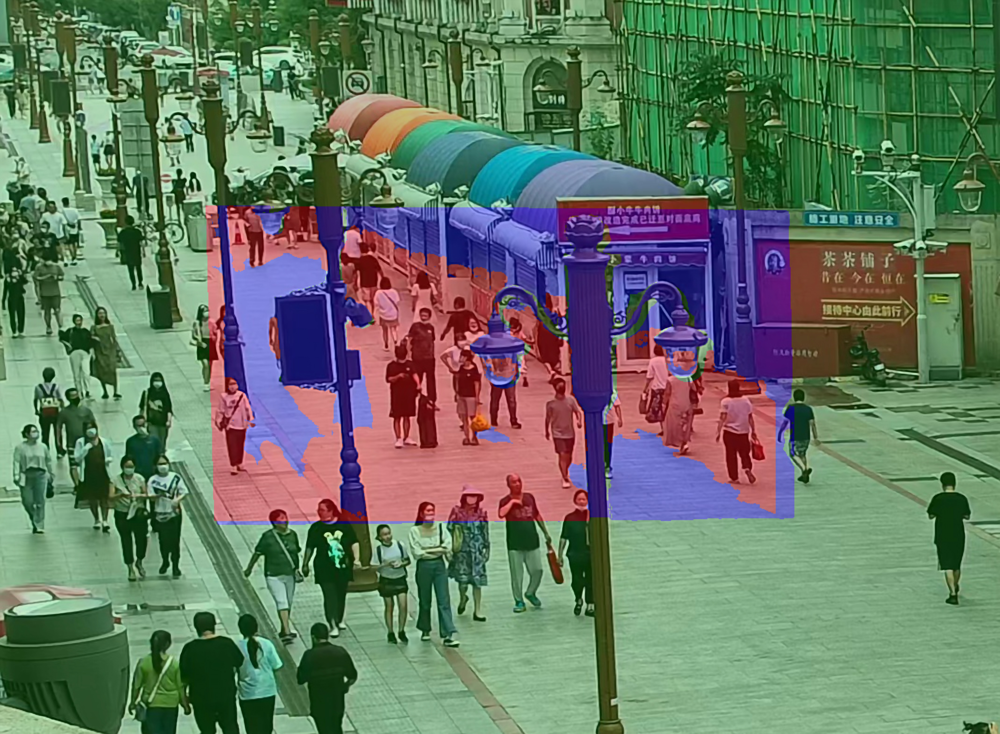
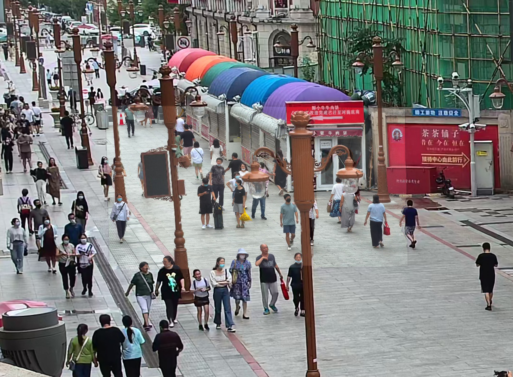
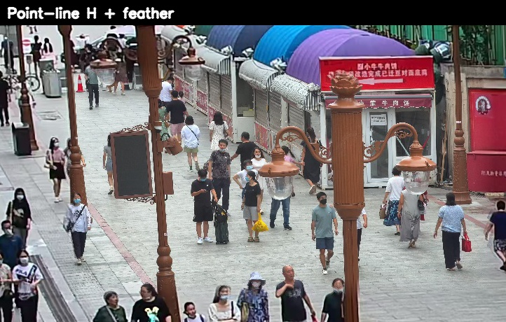
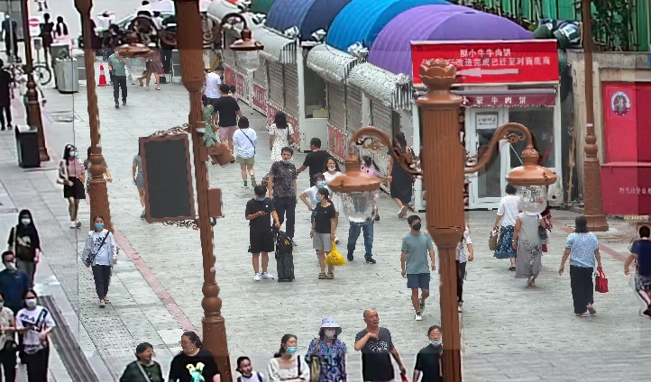

# image_stitch

来自原工程 `image_stitching` 的跨视角图像拼接项目。仓库按算法分为三块；目前前两块有代码、真实输入和可复现输出，视频背景去除留待后续整理。

| 模块 | 用途 | 可运行样例 |
| --- | --- | --- |
| [`image_stitch`](docs/image_stitch.md) | OmniGlue 点匹配 + LineTR 线匹配，估计/精修单应性并羽化拼接 | 运动场、展厅、校园道路各一组图像 |
| [`three_region_stitch`](docs/three_region_stitch.md) | 双视角视频运动掩膜 + 点线运动区单应性 + RAFT 静态区 + Global 背景合图 | 商街人群双视角 200 帧短视频 |
| `video_background_removal` | 视频背景去除 | 后续加入 |

## 1. 纯点线单应性拼接

输入是 Local 和 Global 两张图像，可选相机标定初值 `H_init`。输出 `H_final`、投影和羽化融合图。三个不同场景的输入、初值局部放大、点线匹配及最终输出见[纯拼接样例说明](docs/image_stitch.md)。


## 2. 运动感知三分区域拼接

### 算法流程

**动机：**

该方法主要处理不同景深的前景与背景在跨视角拼接时产生的视差错位。例如，树木、路灯杆等近景结构与远处地面背景的投影关系不同，单个全局单应性难以同时对齐两者，而人或车运动的区域一般认为是地面（背景部分），地面以上非运动的部分认为是景深较浅的前景部分，因此分区域进行拼接。

**方法：**

Local 和 Global 短视频生成的运动掩膜用于辅助划分融合区域，两侧都检测到运动的重叠区域，通过点线匹配精修单应性后投影 Local；其他有效的 Local 重叠区域由 RAFT 光流对齐；其他剩余部分，使用 FSRCNN x4 处理后的 Global 背景。

**输入与输出：**

输入包括同步的 Local/Global 图像、相机标定得到的初始单应矩阵 `H_init`，以及两路相机对应的视频片段。

1. **建立几何初值**：用 `H_init` 把 Local 映射到 Global 坐标系，作为两视角对齐的起点。
2. **提取运动线索并精修单应性**：分别从两路视频生成运动掩膜。点线匹配只采用两侧都检测到运动的对应，用于精修 `H_init`，得到投影 Local 的单应性。
3. **统一掩膜和投影坐标**：把 Local 运动掩膜按精修后的变换更新到 Global 坐标，并计算 Local 投影的有效范围。这样就能在同一张 Global 画布上比较两侧的运动区域和 Local 有效区域。
4. **按像素来源划分三区**：

   | 区域 | 归属规则 | 使用的图像 |
   | --- | --- | --- |
   | 红色：运动区单应性 | 两侧都检测到运动，且 Local 投影有效 | 单应性投影后的 Local |
   | 蓝色：RAFT 区 | 其他有效 Local 区域中，通过 RAFT 前后向一致性检查的部分；默认包含只有一侧检测到运动的区域 | RAFT 对齐后的 Local |
   | 绿色：Global 背景区 | 剩余区域，包括 Local 投影无效或 RAFT 检查失败的位置 | FSRCNN x4 处理后的 Global 背景 |

   三个区域互不重叠，并覆盖整张 Global 画布。运动掩膜标记的是视频中随时间发生变化的位置，不是前景/背景语义标签。它帮助选择融合路径；树木、路灯杆等静止近景如果产生局部视差，会由 RAFT 区尝试对齐，RAFT 不可靠时则使用 Global 背景。
5. **合成高分辨率结果**：先对 Global 背景执行 FSRCNN x4，再将红色单应性区域和蓝色 RAFT 区域的 Local 内容合入对应位置。仅在三区边界附近羽化，默认半径为原画布 2 px。

当前展示这一组商街样例。Local 输入保留相机原始的 3840 × 2160 分辨率；Local/Global 输入、200 帧 ROI 视频、缓存的掩膜/RAFT 中间结果、最终图和同范围对照均在仓库中。视频是真实相机帧，不是合成运动。详见[三分区域算法、数据与复现](docs/three_region_stitch.md)。

### 商街人群 · `20220806141041707_cam11`

#### 输入图像

| Local 输入 | Global 输入 |
| --- | --- |
|  |  |

两图是同步的 Frame 6000 输入：Local 为相机原始全幅（3840 × 2160），Global 为去畸变并裁剪后的输入（1070 × 786）。

#### 区域归属与最终融合

| 三区归属图 | 最终融合结果 |
| --- | --- |
|  |  |

左图叠加在 FSRCNN x4 Global 背景上，以硬掩膜颜色显示归属：红色为 Local 与 Global 双运动掩膜交集内且 Local 投影有效的单应性区，蓝色为红区外通过 RAFT 前后向一致性检查的 Local 区域，绿色由 Global 保留。右图以相同的 x4 Global 为背景合入 Local 内容，并在区域交界处高斯羽化（原画布半径 2 px，放大后 8 px）。

#### 同一 ROI 拼接对照

| 纯点线单应性拼接 | 三分区域融合 |
| --- | --- |
|  |  |

两图为相同 Global ROI 的原始拼接结果裁剪，不叠加标题框；纯点线结果使用 32 px 边缘羽化，三分区域结果在三区交界处以原画布半径 2 px 羽化。

#### 静态区域误差热图


热图比较纯点线单应性和 RAFT 静态区相对 Global 的像素误差；蓝色误差较小，红色较大，黑色表示不在共同静态评测区域内，用于观察静态区对齐。

## 快速运行

在 Python 3.10–3.12 环境中安装基础包，然后运行缓存复现。仓库内附 FSRCNN x4 权重，并缓存真实视频运行得到的运动掩膜、点线精修矩阵和 RAFT 对齐结果；程序会重新完成三区归属、Global 背景超分和融合。

```bash
git clone --recursive https://github.com/liuyuxiang1021/image_stitch.git
cd image_stitch
python -m pip install -e .
three-region-stitch --example examples/three_region_stitch/20220806141041707_cam11
```

输出在该样例的 `output/three_region/`：`final_result.jpg` 是原画布分辨率融合结果，`final_result_global_fsrcnn_x4.jpg` 是 Global 背景经 FSRCNN x4 后再合入 Local 区域的高分辨率结果，`region_overlay_on_global_fsrcnn_x4.jpg` 展示同一高分辨率背景上的区域归属，`pure_stitch_focus.jpg` 与 `three_region_focus.jpg` 是同一 ROI 的两张独立对照图，`summary.json` 记录矩阵、运行模式与像素数。可用 `--sr-mode none` 跳过超分；可用 `--motion-mode recompute` 从随附视频重新生成两个掩膜。完整点线匹配和 RAFT 重算需要模型安装，命令见[三分区域文档](docs/three_region_stitch.md)。纯拼接运行命令见[纯拼接文档](docs/image_stitch.md)。

## 同场景小规模评测

用各场景的 Frame 6000 和对应 `H_init` 运行纯 OmniGlue + LineTR 单应性拼接、OpenCV SIFT + RANSAC 单应性，以及运动区单应性 + RAFT 静态区。只在三种方法共同有效、且双视角均判为静态的像素上，计算与 Global Frame 6000 的 PSNR/SSIM；这衡量**静态重叠区对齐**，不等于整图视觉质量，也不是公开数据集的官方排名。

| 场景 | SIFT + RANSAC | 纯点线 H | 三分区域的 RAFT 静态区 |
| --- | --- | --- | --- |
| 商街人群 | 16.54 dB / 0.528 | 16.75 dB / 0.550 | **18.24 dB / 0.670** |

表内数值由[`scripts/evaluate_three_region.py`](scripts/evaluate_three_region.py)生成；像素数、匹配数、SIFT 输出和精确数值见该样例的 `output/benchmark/`。运动目标没有无遮挡的真值，不能从这些静态区指标推断其融合质量；请同时查看并排图和区域图。

## 仓库结构

```text
src/image_stitch/                # 纯点线单应性与羽化融合
src/three_region_stitch/         # 双运动掩膜、运动区 H、RAFT、三区合图
examples/image_stitch/           # 三组静态图像输入与输出
examples/three_region_stitch/    # 三组双视角视频输入与输出
docs/                            # 算法、数据、评测及运行细节
third_party/                     # 官方 OmniGlue、LineTR、RAFT Git submodules
scripts/                         # 模型准备、样例导出、评测
```

`video_background_removal` 目前没有实现或样例，后续再加入。LineTR 的许可证限制为学术或非营利机构的非商业研究用途，使用前请阅读 [`third_party/LineTR/LICENSE`](third_party/LineTR/LICENSE)。
