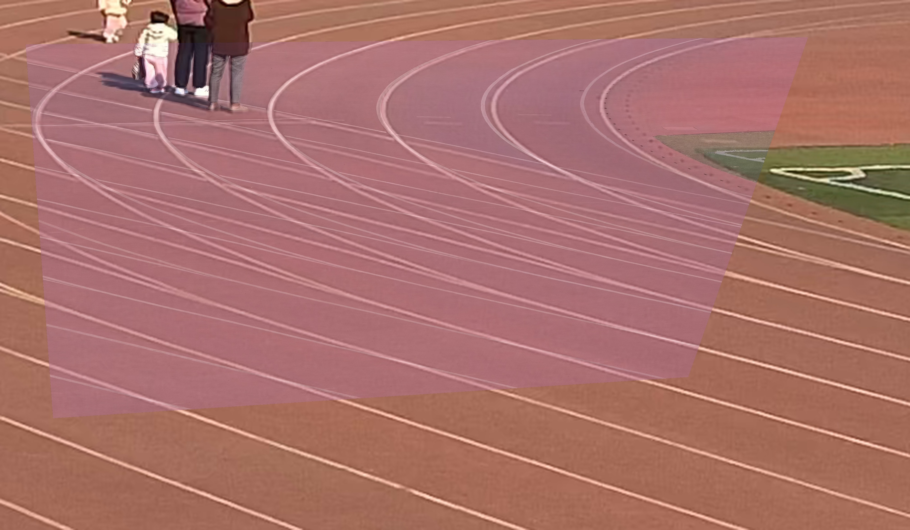
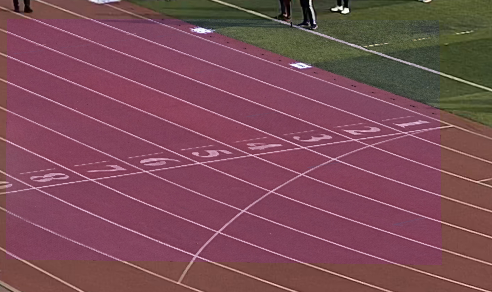
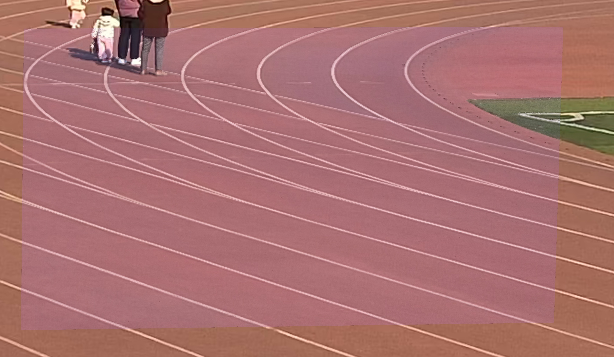
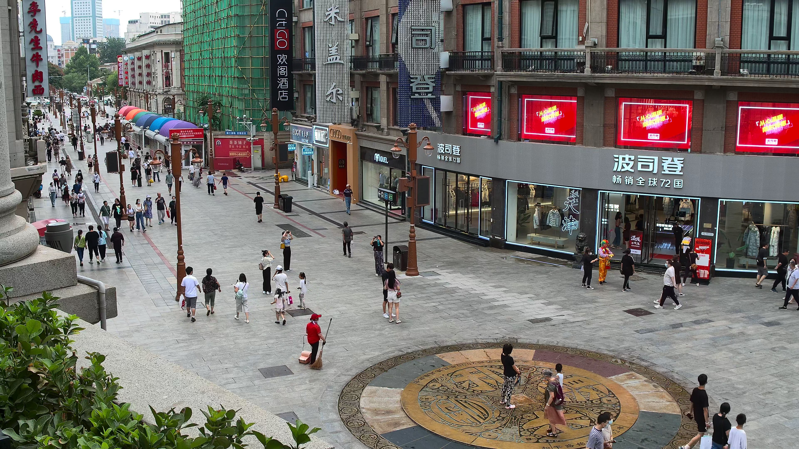
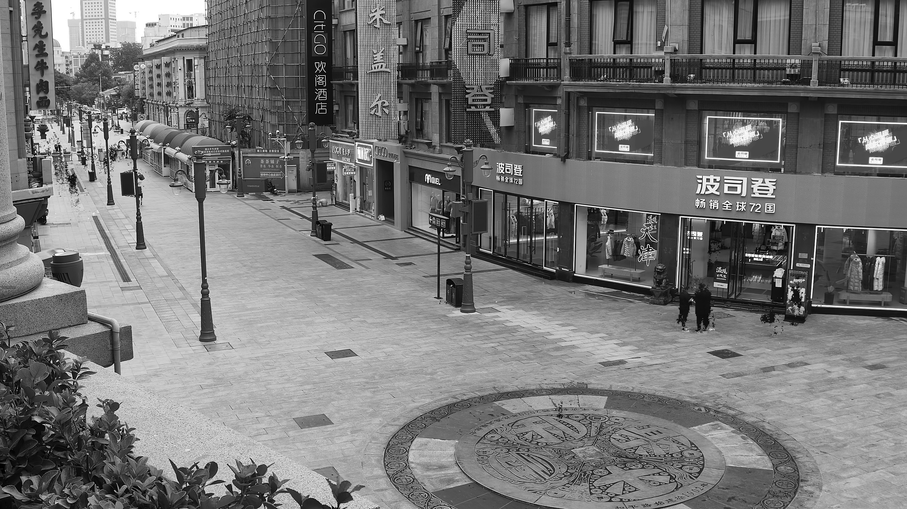
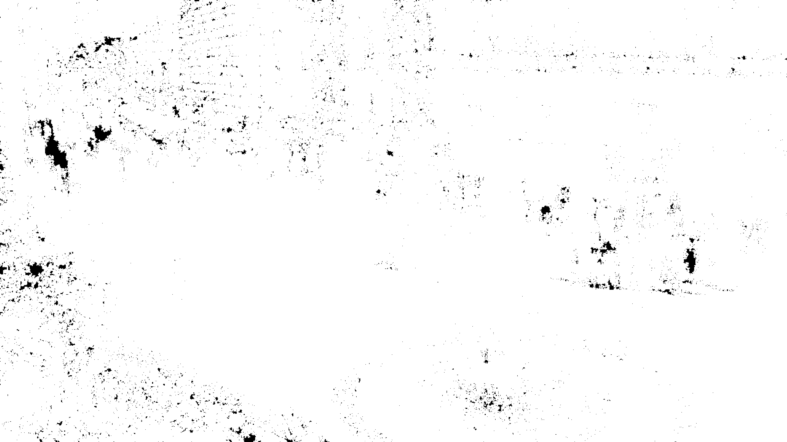
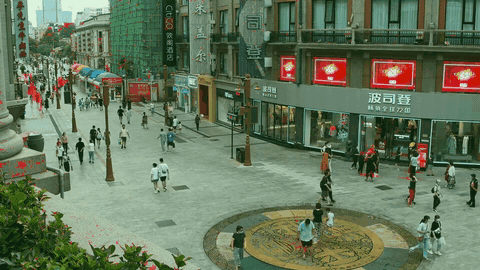

# image_stitch

包含三类图像与视频处理算法，每类提供代码、样例数据和运行结果。

| 模块 | 功能 | 样例 |
| --- | --- | --- |
| [纯点线单应性拼接](docs/point_line_stitch.md) | OmniGlue 点匹配与 LineTR 线匹配，精修单应性并融合图像 | 五组双视角图像 |
| [运动感知三分区域拼接](docs/three_region_stitch.md) | 结合单应性、RAFT 与 Global 背景进行分区融合 | 五组双视角视频样例 |
| [视频静态背景提取](docs/video_background_removal.md) | 用时序 GMM 提取静态背景，并生成连通性掩码 | 商街 Global 视频 |

双视角样例以 Global 帧为基准配对 Local 帧，详见[帧配对说明](docs/frame_synchronization.md)。

## 1. 纯点线单应性拼接

输入 Local、Global 图像和可选的标定初值 `H_init`。提供初值时，先用它定位重叠区域，再通过 OmniGlue 点匹配与 LineTR 线匹配联合精修单应性；没有初值时，直接估计单应性。随后按重叠区域校正颜色并羽化融合；输出包含原分辨率结果和 Local 附近的高分辨率结果。

下方展示 `20201024084037322/cam11` 样例，其余四组见[纯拼接样例说明](docs/point_line_stitch.md)。

| Local 输入 | Global 输入 |
| --- | --- |
|  |  |

### 拼接结果

| Global 局部背景 | 纯点线单应性拼接 |
| --- | --- |
|  |  |

### SIFT + RANSAC 定性对照

下图为同组 Local/Global 的 50:50 叠加。

| 方法 | `20201025083303988/cam34` | `20260109122648396/cam22` | `20220601174105159/cam31` |
| --- | --- | --- | --- |
| SIFT + OpenCV RANSAC |  |  | ❌ 无可用拼接结果 |
| OmniGlue + LineTR 点线 |  |  |  |

## 2. 运动感知三分区域拼接

该方法用于缓解不同景深结构的跨视角视差。Local 和 Global 视频生成的运动掩膜及 Local 投影有效性共同决定像素来源：

- **红色：** 两侧运动掩膜在 Global 坐标中的交集，且 Local 投影有效；使用点线精修后的单应性结果。
- **蓝色：** 其他 Local 有效区域中通过 RAFT 前后向一致性检查及碎片清理的部分；使用 RAFT 对齐结果。
- **绿色：** 其余区域；保留 Global 背景。

默认对红、蓝区域共用一套 HHM 色彩校正，将 Global 背景放大为 x6，并在区域边界羽化。

下方展示 `20220806141041707/cam11` 样例，其余四组见[三分区域样例说明](docs/three_region_stitch.md)。

| Local 输入 | Global 输入 |
| --- | --- |
|  |  |

| 三区归属图 | x6 最终融合 |
| --- | --- |
|  |  |

### Local 区域拼接对照

| 纯点线单应性拼接 | 三分区域融合 |
| --- | --- |
|  |  |

### 五组样例评测

表中为五组样例的等权平均。评测指标比较三种拼接结果与同区域的 x6 Global 背景，表示相似程度；逐组数据见[评测结果](examples/three_region_stitch/selected_1000f/metrics.json)。

| 指标 | SIFT + OpenCV RANSAC | 纯点线（OmniGlue + LineTR） | 三分区域融合 |
| :---: | :---: | :---: | :---: |
| PSNR（dB） | 20.469 | 20.626 | **23.043** |
| SSIM | 0.6767 | 0.6834 | **0.7172** |

## 3. 视频静态背景提取

时序 GMM 对灰度图像块建模，取权重最大的分量均值并平均重叠区域，得到静态背景。另根据相邻背景块的重叠误差生成连通性掩码。

下方为商街 Global 原始视频、500 帧 GMM 背景结果和连通性掩码。4 个并行任务耗时约 2 小时；可运行的小样例和参数说明见[视频背景提取文档](docs/video_background_removal.md)。

| 原始 Global 帧 | GMM 背景 | 连通性掩码 |
| --- | --- | --- |
|  |  |  |

原始 4K Global 视频通过 Git LFS 提供，仓库也包含可运行的小样例。

### 视频与掩码叠加

演示将 500 帧得到的连通性掩码叠加到连续 2000 帧视频中：绿色为掩码保留区域，红色为掩码未覆盖区域。



[播放完整演示视频](examples/video_background_removal/20220806141041707_cam100/full_global_review/output/static_mask_on_full_video_4001_6000_960x540.mp4) · [获取原始 4K Global 视频](examples/video_background_removal/20220806141041707_cam100/full_global_review/input/global_video.mp4)

## 快速运行

Python 3.10–3.12 环境安装后，可运行缓存样例：

```bash
git clone --recursive https://github.com/liuyuxiang1021/image_stitch.git
cd image_stitch
python -m pip install -e .
three-region-stitch --example examples/three_region_stitch/selected_1000f/20220806141041707_cam11
```

完整重算命令和输出文件说明见各模块文档。

## 仓库结构

```text
src/point_line_stitch/             纯点线单应性拼接
src/three_region_stitch/           运动感知三分区域拼接
src/video_background_removal/      视频静态背景提取
examples/                          样例输入、缓存和结果
docs/                              算法与运行说明
scripts/                           样例导出、评测和模型准备
third_party/                       OmniGlue、LineTR、RAFT 子模块
```

LineTR 仅允许学术或非营利机构进行非商业研究，使用前请阅读 [`third_party/LineTR/LICENSE`](third_party/LineTR/LICENSE)。
