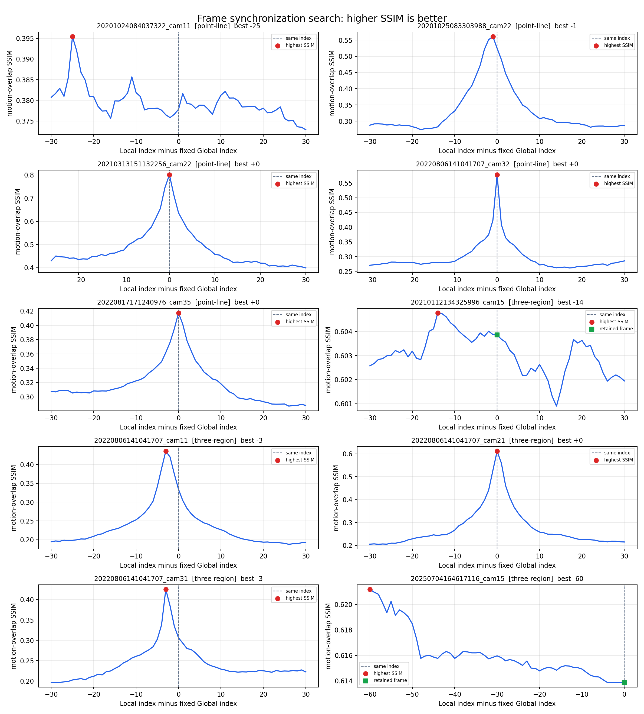

# 双视角帧配对

[返回项目首页](../README.md)

以下帧号均从 0 开始计数。固定一帧 Global，在相邻 Local 帧中搜索与之对应的图像。每个候选先用已估计的单应矩阵投到相同的 Global ROI；评分只取 Global 目标帧附近出现变化、且 Local 投影有效的像素，计算灰度 SSIM。这样大量未变化的背景和合图中原样保留的 Global 像素不会抬高分数。**SSIM 越高越好**，但跨视角视差、遮挡和颜色差异仍会影响它。

默认搜索前后 30 帧；最高点落在边界时扩大搜索。仅当最高点在搜索区间内部，且比当前帧高至少 0.01 时采用新帧。否则保留当前帧并记录原因。`20250704164617116_cam15` 已扩到前 60 帧，画面中缺少可用于判断同步的运动目标，曲线仍在边界缓慢上升，因此没有据此改帧。



| 模块与样例 | Global 帧 | 最高分 Local 帧 | 实际采用 Local 帧 | 判定 |
| --- | ---: | ---: | ---: | --- |
| 点线 · 20201024084037322_cam11 | 50 | 25 | 25 | 明显峰值 |
| 点线 · 20201025083303988_cam22 | 6000 | 5999 | 5999 | 明显峰值 |
| 点线 · 20210313151132256_cam22 | 26 | 26 | 26 | 原帧最高 |
| 点线 · 20220806141041707_cam32 | 6000 | 6000 | 6000 | 原帧最高 |
| 点线 · 20220817171240976_cam35 | 50 | 50 | 50 | 原帧最高 |
| 三区 · 20210112134325996_cam15 | 6000 | 5986 | 6000 | 分数差不足 |
| 三区 · 20220806141041707_cam11 | 6000 | 5997 | 5997 | 明显峰值 |
| 三区 · 20220806141041707_cam21 | 6000 | 6000 | 6000 | 原帧最高 |
| 三区 · 20220806141041707_cam31 | 6000 | 5997 | 5997 | 明显峰值 |
| 三区 · 20250704164617116_cam15 | 1349 | 1289 | 1349 | 边界且分数差不足 |

每组 `sync/` 保存投影后的 Local 搜索片段、固定 Global ROI、评分掩膜、逐帧分数和选择原因。可在仓库根目录复算：

```bash
python scripts/select_sync_frame.py --example examples/three_region_stitch/selected_1000f/20220806141041707_cam11
```

`scripts/prepare_sync_windows.py` 可由原始视频重新导出搜索片段；该脚本需要原工程的 4K 视频和 Global 标定文件。改变 Local 帧后，点线样例重估单应性；三区样例将 Local 的 1000 帧片段整体平移，使它以新目标帧结束，再重算运动掩膜、运动区单应性和 RAFT 缓存。Global 帧及其 1000 帧片段保持固定。
