# 运动感知三分区域拼接

[返回项目首页](../README.md)

## 样例与文件组织

仓库包含三个同步双视角场景：商街人群 `20220806141041707_cam11`、城市道路 `20210304162543165_cam11` 和运动场人群 `20220601174105159_cam11`。每组静帧对应 Frame 6000；每个视角另有第 5801–6000 帧、25 fps 的 200 帧真实视频片段。

每组样例统一分为原始输入、处理中间缓存和输出：

| 目录 | 内容 |
| --- | --- |
| `input/` | 同步 Local/Global 静帧、标定初值 `H_init.npz`，以及两路 ROI 视频 |
| `cache/` | 点线精修矩阵、Local/Global 运动掩膜、RAFT 对齐图、有效性掩膜和光流场；缓存均可由输入视频与模型重新生成 |
| `output/` | `pure_artifacts/` 保存纯点线结果与匹配可视化；`three_region/` 保存三区结果和中间可视化；`benchmark/` 保存近 4K 局部对照及 PSNR/SSIM |

`manifest.json` 分别列出 `inputs`、`cache` 和 `outputs` 的路径、源视频帧范围及 ROI 坐标。样例输入中，Local 是相机原始 3840 × 2160 图像，Global 是去畸变并裁剪后的 1070 × 786 图像；矩阵坐标对应这两张实际输入。

## 算法流程

运动掩膜作为区域先验，辅助处理不同景深的前景和背景在跨视角下产生的视差错位。树木、路灯杆等静止近景与较远背景通常不能由同一个单应性同时对齐；运动掩膜表示视频片段中曾变化的位置，不是语义前景/背景分割。

1. **计算双视角运动掩膜。** Local 和 Global 视频分别独立生成掩膜，标出片段中出现过运动的位置。
2. **精修运动区单应性。** 使用 `H_init` 将 Local 投到 Global 坐标，在两侧运动掩膜限定的区域内进行 OmniGlue 点匹配与 LineTR 线匹配，联合精修得到 `H_final = H_delta @ H_init`。若有效匹配不足，则沿用初值。
3. **对齐掩膜并划分红区。** 将 Local 初始运动掩膜按 `H_delta` 更新到 `H_final` 对应的 Global 坐标，再与 Global 运动掩膜及 Local 有效投影区域取交集。红区使用 `H_final` 投影的 Local。
4. **划分蓝区和绿区。** 红区之外的 Local 有效区域交给双向 RAFT；前后向一致性通过且有效的像素归蓝区。包括只有一侧检测到运动、因双掩膜交集而未进入红区的位置。RAFT 形态学清理会去除零散小区域，被移除的位置由 Global 接管。其余位置归绿区，使用 Global。
5. **估计颜色映射并合成 x6 结果。** 将 Global 画布整体先用 Lanczos 插值放大 1.5 倍，再执行 FSRCNN x4，得到 x6 背景。从红、蓝区域分别采样与 Global 对齐的像素对，共同估计一套 HHM 映射，并对两路 Local 来源应用同一映射。纯点线单应性结果则根据自身 Local/Global 重叠像素单独估计 HHM 映射。Local 使用原始图像直接投影到 x6 画布；RAFT 光流位移乘以 6 后作用于高分辨率 Local 投影，掩膜同步按最近邻放大。
6. **在区域边界羽化。** 只在红、蓝、绿区域交界处做高斯权重羽化，默认半径为原画布 6 px，即 x6 输出 36 px。纯点线对照使用相同的 6 px 原画布边缘羽化。

HHM 默认开启。可用 `--no-color-correction` 关闭，或用 `--color-correction-coeff`、`--color-correction-threshold` 调整映射。

## 运行样例

基础复现使用仓库中的真实输入和缓存，不需要 GPU 或下载 RAFT、OmniGlue、LineTR 权重；FSRCNN x4 权重随仓库提供。

```bash
python -m pip install -e .
three-region-stitch --example examples/three_region_stitch/20220806141041707_cam11
```

将样例路径替换为城市道路或运动场目录，可运行另外两个场景。缓存复现会重新计算三区归属、HHM 映射和 x6 融合。要重新生成某类缓存，可使用 `--motion-mode recompute`、`--geometry-mode recompute` 或 `--flow-mode raft`；从原视频到 RAFT 全部重算见下文。

从视频、点线匹配到 RAFT 全部重算需要准备模型：

```bash
bash scripts/setup_models.sh
bash scripts/setup_raft.sh
three-region-stitch --example examples/three_region_stitch/20220806141041707_cam11 --recompute-all --gpu 0
```

安装脚本优先直连下载；只有本机直连失败时才重试当前网络配置。RAFT 权重来自[官方 RAFT 仓库](https://github.com/princeton-vl/RAFT)，OmniGlue 和 LineTR 的准备见[纯拼接说明](image_stitch.md)。没有 NVIDIA GPU 时可设 `--device cpu`，推理耗时会增加。

## 三个场景的输出

下方区域图用红、蓝、绿显示每个 x6 Global 画布中的像素归属；融合图展示相同画布上的最终结果。局部对照为纯点线单应性与三分区域结果，均使用独立估计的颜色映射和 6 px 原画布羽化，裁剪范围相同，为 Local 投影范围外加 24 px 留白。

### 商街人群 · `20220806141041707_cam11`

| 三区归属图 | x6 最终融合 |
| --- | --- |
| 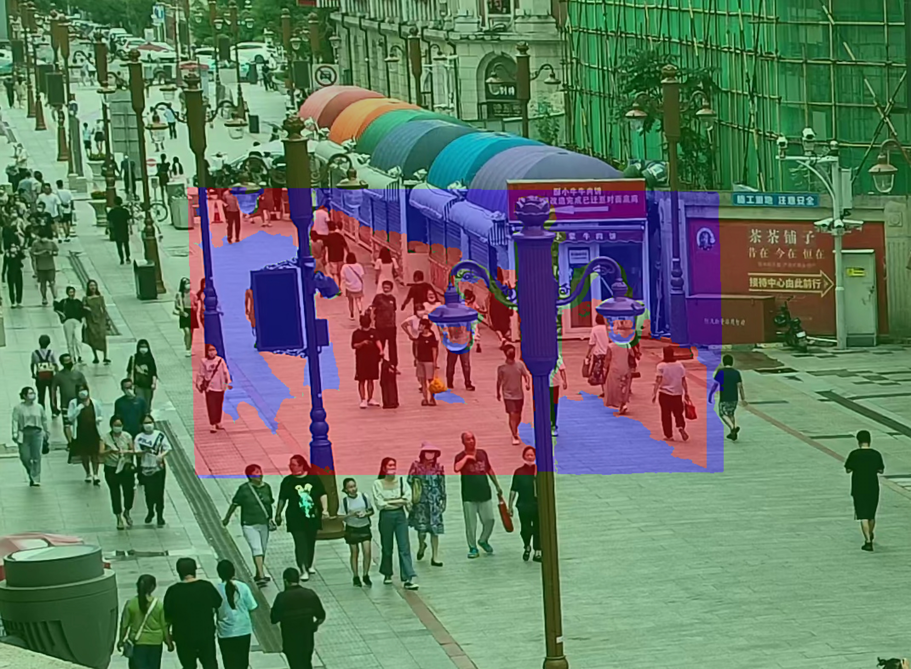 | 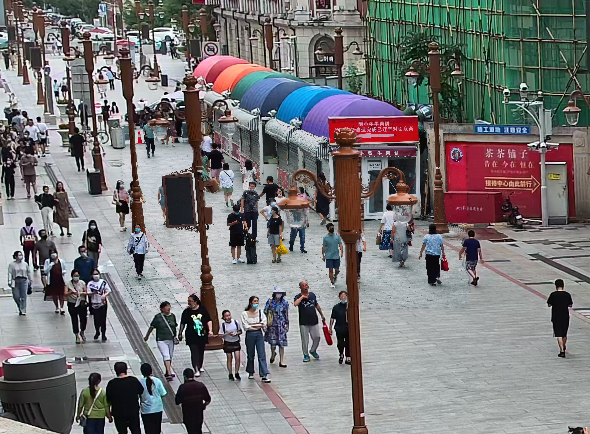 |

| 纯点线单应性 | 运动感知三分区域 |
| --- | --- |
| 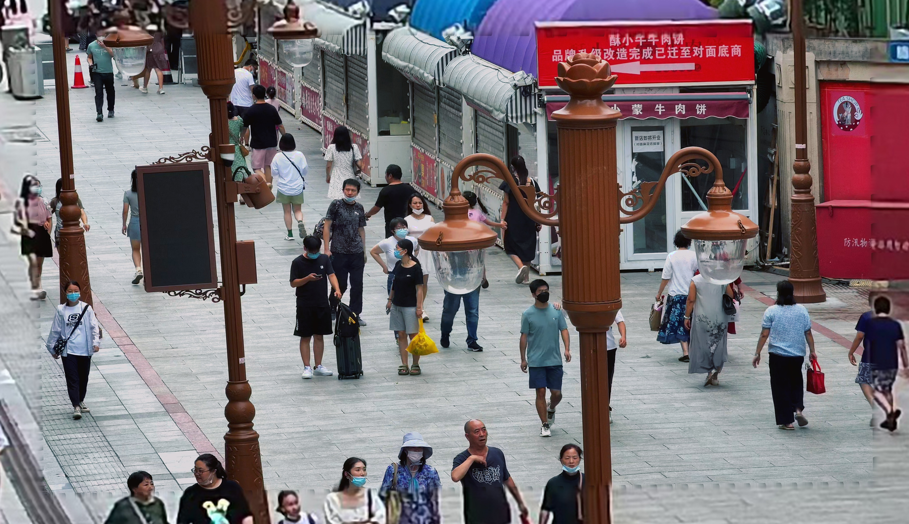 |  |

### 城市道路 · `20210304162543165_cam11`

| 三区归属图 | x6 最终融合 |
| --- | --- |
| 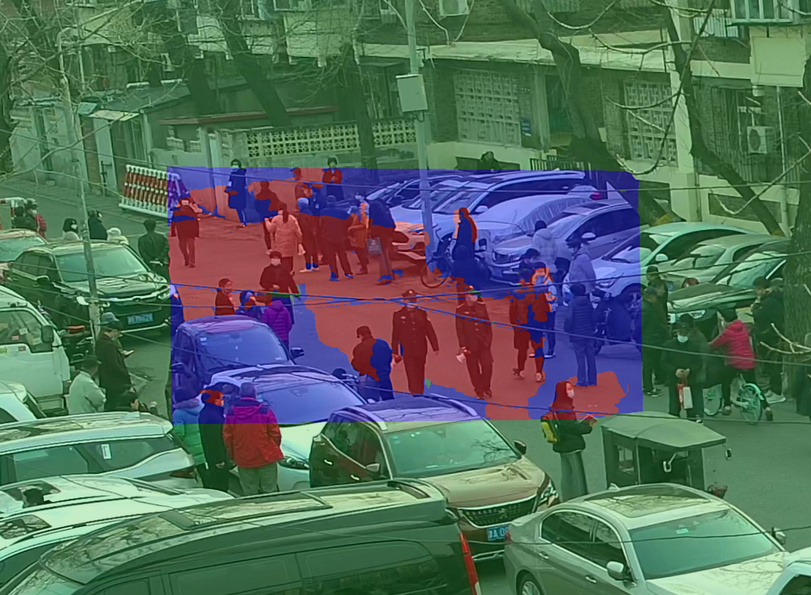 | 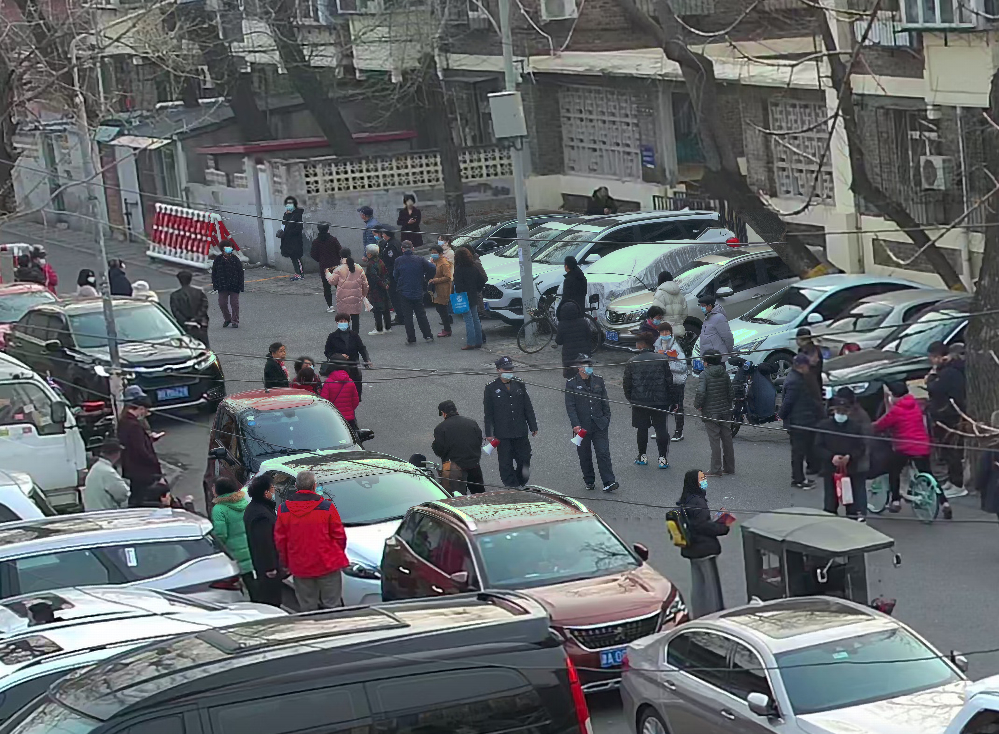 |

| 纯点线单应性 | 运动感知三分区域 |
| --- | --- |
| 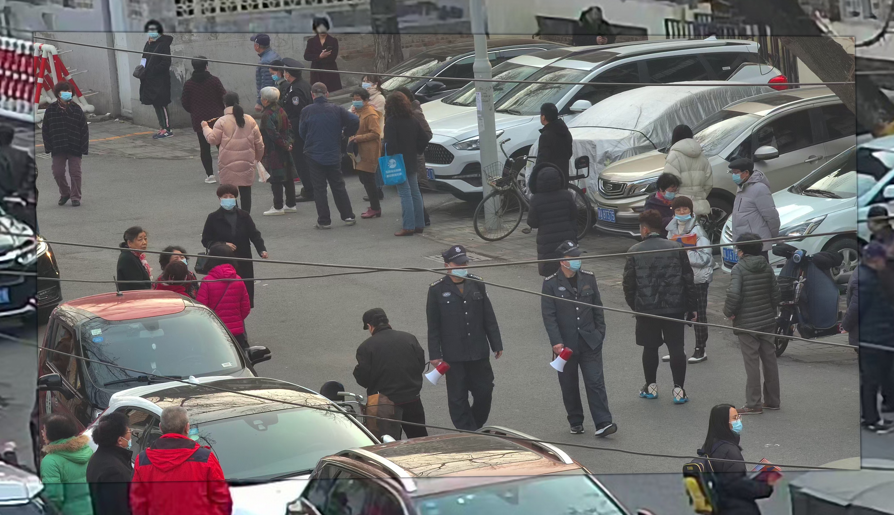 | 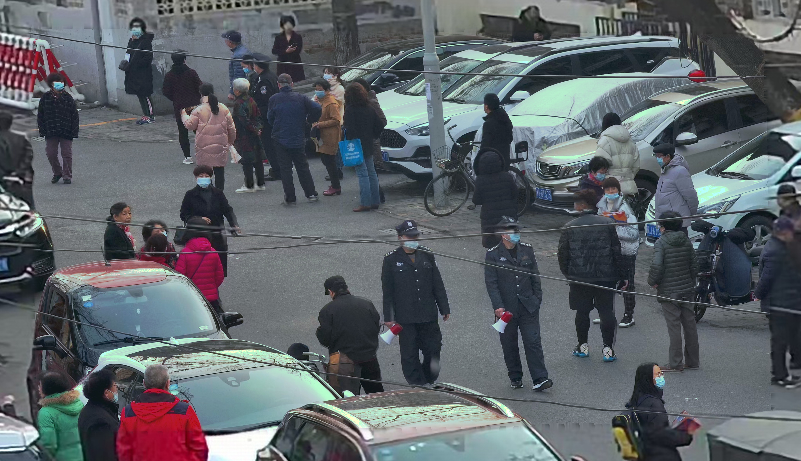 |

### 运动场人群 · `20220601174105159_cam11`

| 三区归属图 | x6 最终融合 |
| --- | --- |
| 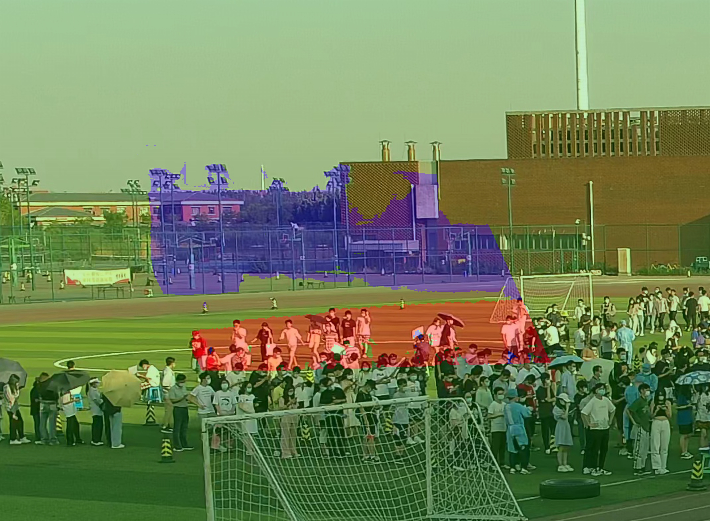 | 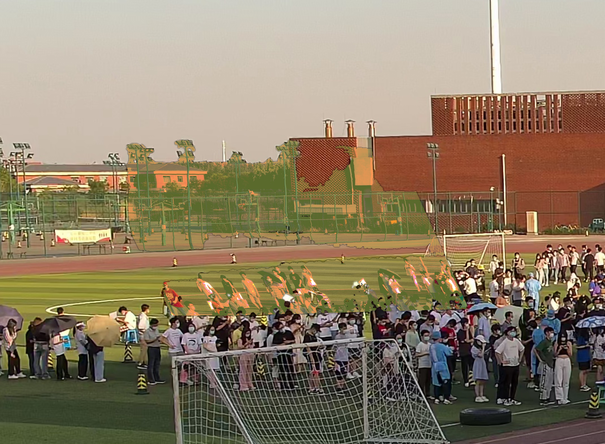 |

| 纯点线单应性 | 运动感知三分区域 |
| --- | --- |
| 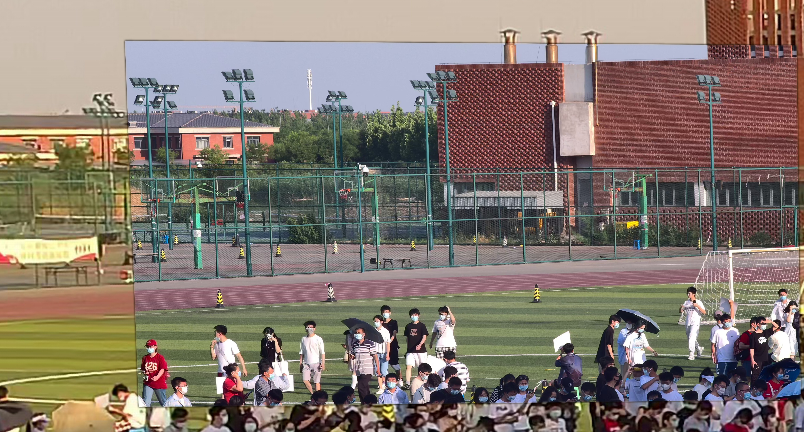 | 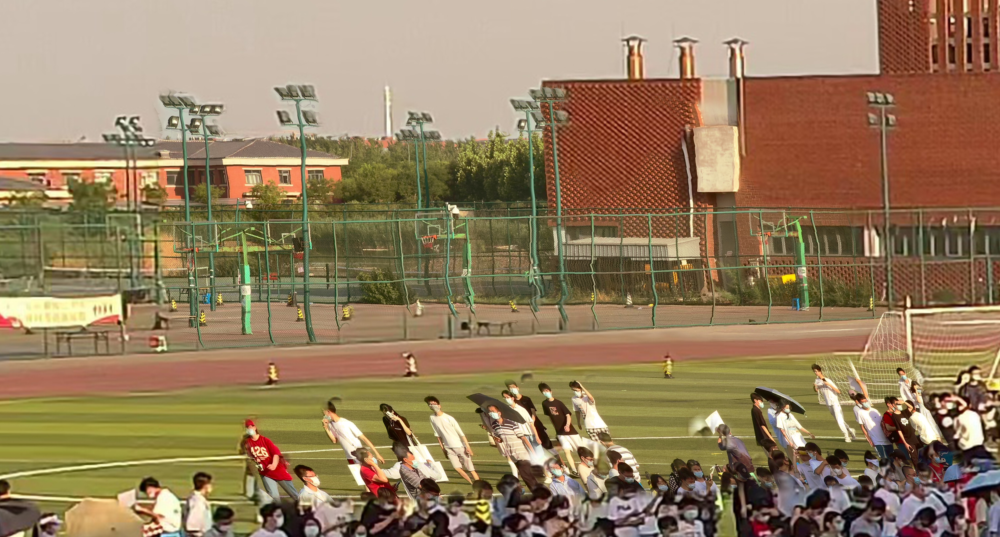 |

`output/three_region/` 还包含原画布诊断图、单应性投影、运动掩膜可视化、各区域二值掩膜和 `summary.json`。完整 Global x6 画布、Local 附近近 4K 裁剪、纯点线对照分别保存在 `final_result_global_fsrcnn_x6.jpg`、`final_result_local_roi_fsrcnn_x6.jpg` 和 `pure_stitch_local_roi_fsrcnn_x6.jpg`。

## 小规模全 ROI 评测

全 ROI 是 Local 投影范围外加 24 px 原画布留白后的区域；每种拼接结果都与同一 x6 Global 背景比较。它不是带有真值的拼接质量分数，绿区由 Global 保留的像素与参照相同，会影响得分。

| 场景 | SIFT PSNR（dB） | 纯点线 PSNR（dB） | 三分区域 PSNR（dB） | SIFT SSIM | 纯点线 SSIM | 三分区域 SSIM |
| --- | ---: | ---: | ---: | ---: | ---: | ---: |
| 商街人群 | 16.665 | 16.533 | **17.395** | 0.5552 | 0.5551 | **0.5879** |
| 城市道路 | **20.497** | 18.627 | 20.579 | **0.6607** | 0.6234 | **0.6788** |
| 运动场人群 | 16.727 | 16.766 | **17.791** | 0.5651 | 0.5613 | **0.7276** |

运行评测：

```bash
python -m pip install -e '.[benchmark]'
python scripts/evaluate_three_region.py --example examples/three_region_stitch/20220806141041707_cam11
```

`metrics.json` 保存 ROI 坐标、像素数、各方法 PSNR/SSIM 和评测口径。这里展示的数值是缓存样例对应的评测结果；重新计算缓存后可按上述命令更新。

## 数据来源

三分区域样例由 `scripts/export_three_region_sample.py` 从原工程视频和标定数据导出。仓库内输入是裁切后可独立运行的小样例，不需要原工程目录或完整视频。
