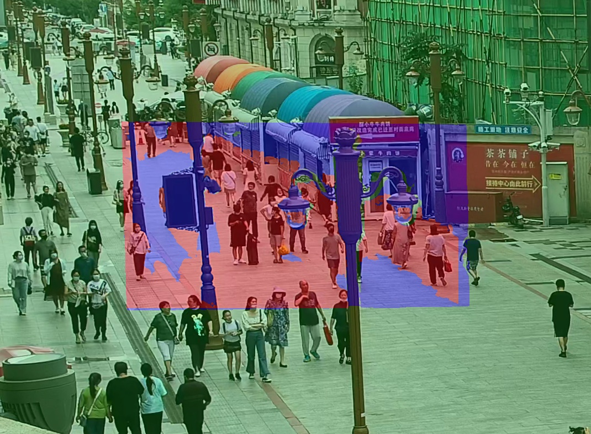
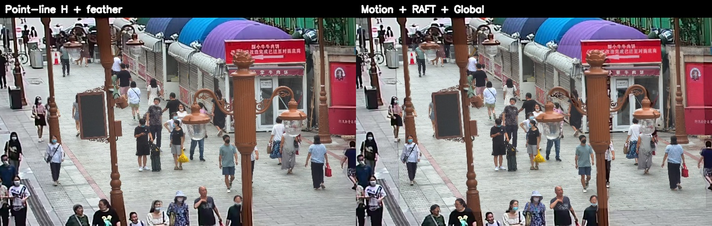
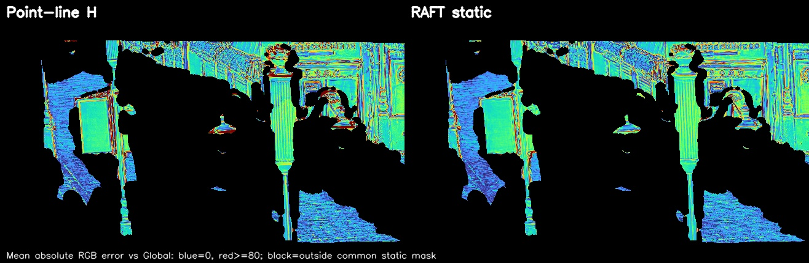
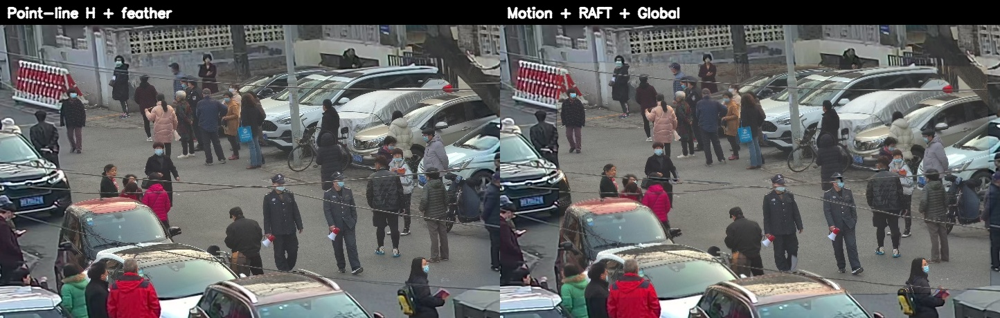
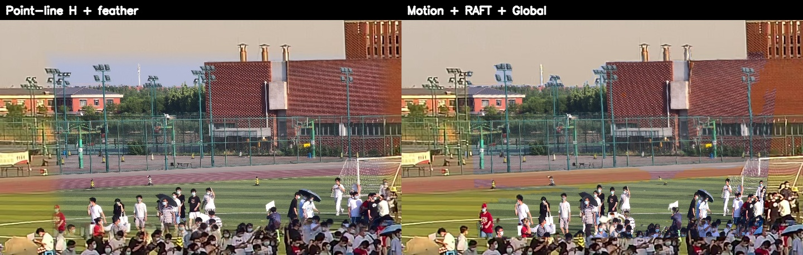
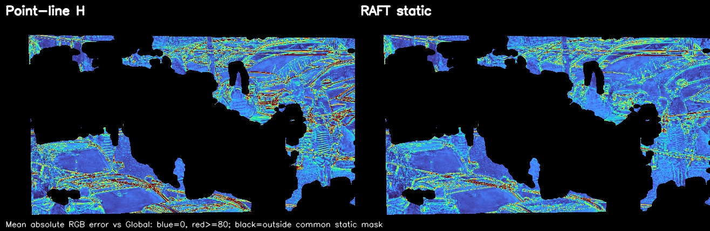

# 运动感知三分区域拼接

[返回项目首页](../README.md)

## 输入、坐标与场景

样例根目录为 `examples/three_region_stitch/<scene>_cam11/`，包含商街人群 `20220806141041707_cam11`、城市道路 `20210304162543165_cam11` 和运动场人群 `20220601174105159_cam11`。每组都有来自两台相机的同步第 6000 帧、原项目相机标定算出的 `H_init`，以及可供缓存复现的点线精修矩阵 `H_final_reference`。为了让数据可随仓库运行，Local 静帧缩至原宽高的一半；Global 截取同一观察区域，所有矩阵已换算为仓库样例坐标。每个视角随附第 5801–6000 帧共 200 帧、25 fps 的真实 ROI 视频。

| 文件 | 含义 |
| --- | --- |
| `input/local.jpg` | 最后一帧 Local 原图，1920 × 1080 |
| `input/global.jpg` | 去畸变 Global 最后一帧的展示裁剪，1070 × 786 |
| `input/H_init.npz` | 标定初值，Local 像素到样例 Global 像素，矩阵键 `H` |
| `input/H_final_reference.npz` | 对应样例掩膜与 RAFT 缓存的点线精修矩阵，用于快速复现 |
| `input/local_init_roi.mp4` | Local 视频经 `H_init` 投影、再截取投影 ROI |
| `input/global_roi.mp4` | Global 视频去畸变后截取同一个 ROI |
| `input/local_motion_init_mask.png`、`input/global_motion_mask.png` | 由上述两个视频分别算出的掩膜缓存 |
| `input/raft_warped.jpg`、`input/raft_valid_mask.png` | RAFT 静态区对齐与前后向有效性缓存 |

`manifest.json` 记录源帧范围、裁剪坐标、ROI 和路径。两个视频长度相同、像素坐标同属初值投影 ROI，但运动掩膜**分别**由各自视频生成。

## 算法

1. 每个视频按 100 帧分段，用逐像素中位帧作参考；当前帧与参考灰度差超过 36 的像素取并集，做 5 × 5 开运算和小连通域过滤，合并分段。得到 `M_local_init` 和 `M_global`。掩膜表达的是这段时间内曾运动的区域，包含位置轨迹，并非最后一帧的人体实例分割。
2. 用 `H_init` 将 Local 最后一帧投到 Global 坐标系，在 ROI 内执行 OmniGlue 点匹配、LineTR 线匹配。点两端、线中点分别必须落在对应视角的运动掩膜内，随后稳健估计增量 `H_delta`，得到 `H_final = H_delta @ H_init`。约束不足时保留 `H_init`，并在 `summary.json` 记录原因。
3. 将 `M_local_init` 经 `H_delta` 变成 `M_local_final`，再在 Global 画布上取交集：`red = M_local_final ∩ M_global ∩ valid_local_final`。这正是双视角都判运动的有效 Local 投影区域，使用 `H_final` 投影的 Local。
4. 其他 Local 有效重叠像素作为静态对齐候选，包括只有一侧判运动而被交集剔除的像素。对 `H_final` 投影的 Local 与 Global 运行双向 RAFT，用前后向误差 < 3 px 和取样有效性过滤；通过的归蓝色 RAFT 区。其余像素保留 Global，归绿色。三区互斥并覆盖整个 Global 画布。
5. 只在三区交界半径 2 px 的邻域做高斯权重羽化。图像仍以 Global 的 1070 × 786 画布输出。红色/蓝色/绿色是可视化着色，`final_result.jpg` 无色框、无伪彩色。

## 复现

基础安装及缓存复现不需要 GPU 或下载权重：

```bash
python -m pip install -e .
three-region-stitch --example examples/three_region_stitch/20220806141041707_cam11
three-region-stitch --example examples/three_region_stitch/20210304162543165_cam11
three-region-stitch --example examples/three_region_stitch/20220601174105159_cam11
```

缓存模式会从真实视频实验保存的掩膜、点线结果矩阵和 RAFT 输出重新计算三区归属与融合。需要重算运动掩膜时：

```bash
three-region-stitch --example examples/three_region_stitch/20220806141041707_cam11 --motion-mode recompute
```

从视频、点线匹配到 RAFT 全部重算需先装模型。安装脚本优先直连下载；只有本机直连失败时才重试当前网络配置。RAFT 权重来自[官方 RAFT 仓库](https://github.com/princeton-vl/RAFT)，OmniGlue、LineTR 的准备见[纯拼接说明](image_stitch.md)。

```bash
bash scripts/setup_models.sh
bash scripts/setup_raft.sh
three-region-stitch --example examples/three_region_stitch/20220806141041707_cam11 --recompute-all --gpu 0
```

`--geometry-mode recompute` 只重算点线矩阵，`--flow-mode raft` 只重算 RAFT；若几何矩阵改变，应同时重算 RAFT，避免复用不同几何下的光流缓存。其他参数可用 `three-region-stitch --help` 查看。无 NVIDIA GPU 也可设 `--device cpu`，推理时间会增加。

## 输出与图示

| 文件 | 说明 |
| --- | --- |
| `output/pure_stitch.jpg` | 同一 Local/Global 最后一帧的完整纯点线 H 拼接对照 |
| `output/three_region/final_result.jpg` | 无标注的最终三分区域融合图 |
| `output/three_region/region_overlay_on_global.jpg` | 原 Global 背景上叠红/蓝/绿三区 |
| `output/three_region/comparison_focus.jpg` | 同一个 ROI：左纯点线 H，右三分区域 |
| `output/three_region/local_global_motion_masks.jpg` | Local/Global 原始 ROI 最后一帧上的各自运动掩膜 |
| `output/three_region/region_*_mask.png` | 三个互斥最终区域的二值掩膜 |
| `output/three_region/summary.json` | 输入模式、单应矩阵、像素计数 |
| `output/benchmark/metrics.json` | SIFT/纯点线 H/RAFT 静态区共同像素的指标 |
| `output/benchmark/static_error_heatmaps.jpg` | 同一静态共同掩膜、同一误差色标下与 Global 参考帧的误差图 |

商街人群的区域图：



商街最后一帧同范围对照：



蓝色代表误差小，红色代表误差大，黑色在共同静态评测掩膜之外；两幅热图使用相同色标。



城市道路最后一帧同范围对照：



运动场人群最后一帧同范围对照：





## 评测协议与边界

三个场景的纯点线输出均用本仓库 `image-stitch` 对**同一帧**重新运行；没有沿用原工程历史“full homography”对照图，因为那批图的全单应性分支未真正启用。另加 [OpenCV SIFT + Lowe ratio test + RANSAC](https://docs.opencv.org/5.0/py_tutorials/py_features/py_feature_homography/py_feature_homography.html) 基线。三个方法共同有效的像素、且 Local/Global 都判静态的部分，做 3 px 腐蚀后作为共同评测掩膜，计算与 Global 最后一帧的 PSNR/SSIM。运行：

```bash
python -m pip install -e '.[benchmark]'
python scripts/evaluate_three_region.py --example examples/three_region_stitch/20220806141041707_cam11
python scripts/evaluate_three_region.py --example examples/three_region_stitch/20210304162543165_cam11
python scripts/evaluate_three_region.py --example examples/three_region_stitch/20220601174105159_cam11
```

| 场景 | 共同静态像素 | SIFT + RANSAC | 纯点线 H | RAFT 静态区 |
| --- | ---: | ---: | ---: | ---: |
| 商街人群 | 74,921 | 16.539 dB / 0.5282 | 16.749 dB / 0.5504 | 18.236 dB / 0.6703 |
| 城市道路 | 99,603 | 19.602 dB / 0.6637 | 17.754 dB / 0.5108 | 20.667 dB / 0.7145 |
| 运动场人群 | 91,812 | 18.111 dB / 0.5468 | 17.850 dB / 0.5115 | 18.499 dB / 0.5508 |

这个诊断只回答“静态重叠像素与 Global 对得怎样”。两相机曝光、遮挡和视角不同，指标本身也会受影响；运动区域没有无遮挡的真值，不能用这些数字评价运动目标的融合质量。[UDIS2 官方仓库](https://github.com/nie-lang/UDIS2)所用的 UDIS-D 是静态图像对数据集，与这里的双视角时序掩膜设置不同，因此没有把本结果写成 UDIS-D 榜单分数。单应性在存在视差和动态物体时可能产生重影，这也是三分区尝试解决的问题；背景参考见[APAP 项目页](https://cs.adelaide.edu.au/~tjchin/apap/)。

## 数据导出

若持有原工程完整 4K 视频、相机标定和历史输出，可以用 `scripts/export_three_region_sample.py` 按同一坐标与编码规则重新导出小样例；脚本不会随仓库安装自动运行。随仓库的样例已经包含运行所需输入，无需原工程目录。
