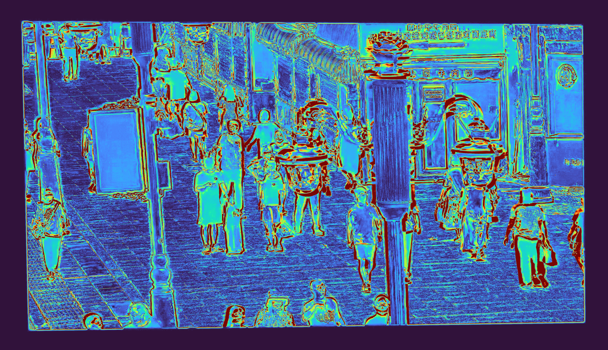
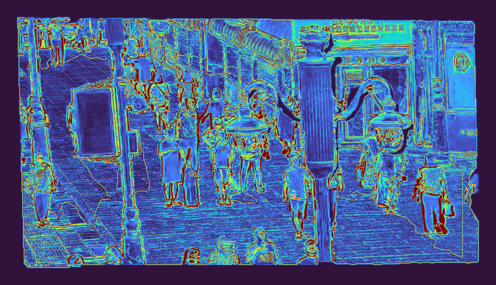
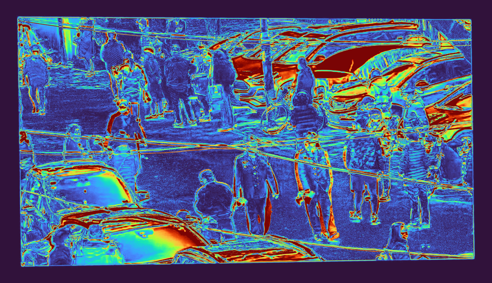
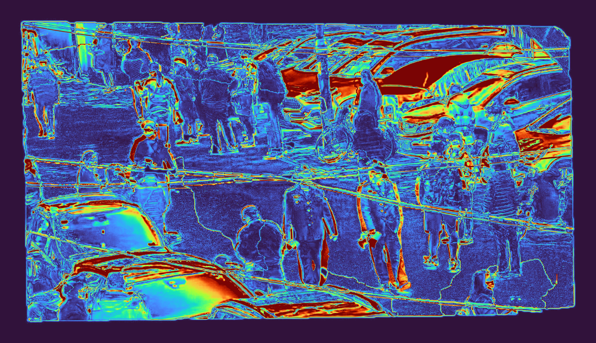
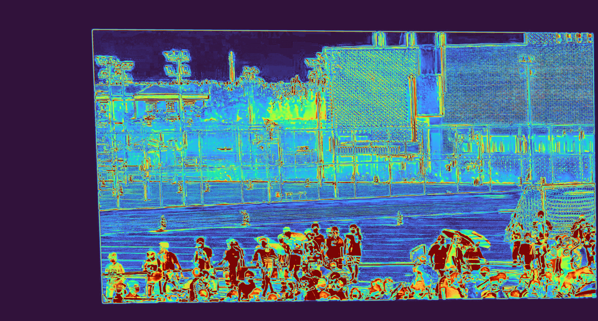
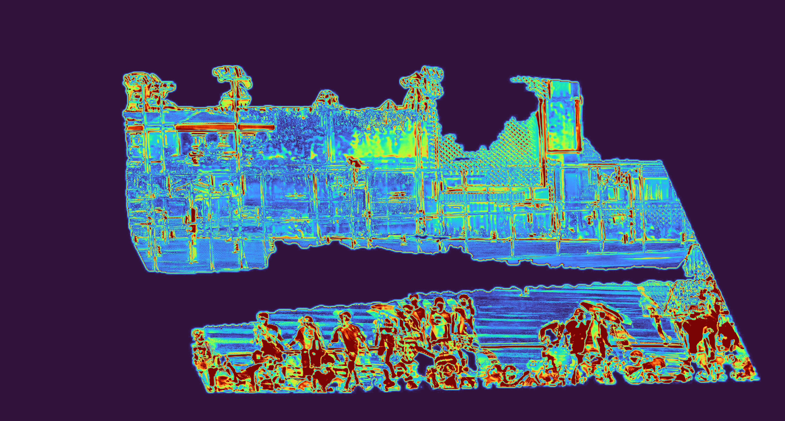

# 运动感知三分区域拼接

[返回项目首页](../README.md)

## 输入、坐标与场景

样例根目录为 `examples/three_region_stitch/<scene>_cam11/`，包含商街人群 `20220806141041707_cam11`、城市道路 `20210304162543165_cam11` 和运动场人群 `20220601174105159_cam11`。每组都有来自两台相机的同步第 6000 帧、原项目相机标定算出的 `H_init`，以及可供缓存复现的点线精修矩阵 `H_final_reference`。Local 静帧保留相机原始的 3840 × 2160 分辨率；Global 截取同一观察区域，矩阵按该原始 Local 坐标和 Global 裁剪坐标保存。每个视角随附第 5801–6000 帧共 200 帧、25 fps 的真实 ROI 视频。

| 文件 | 含义 |
| --- | --- |
| `input/local.jpg` | Frame 6000 的 Local 原图，3840 × 2160 |
| `input/global.jpg` | 去畸变并裁剪后的 Global Frame 6000 输入图，1070 × 786 |
| `input/H_init.npz` | 标定初值，Local 像素到样例 Global 像素，矩阵键 `H` |
| `input/H_final_reference.npz` | 对应样例掩膜与 RAFT 缓存的点线精修矩阵，用于快速复现 |
| `input/local_init_roi.mp4` | Local 视频经 `H_init` 投影、再截取投影 ROI |
| `input/global_roi.mp4` | Global 视频去畸变后截取同一个 ROI |
| `input/local_motion_init_mask.png`、`input/global_motion_mask.png` | 由上述两个视频分别算出的掩膜缓存 |
| `input/raft_warped.jpg`、`input/raft_valid_mask.png` | RAFT 静态区对齐与前后向有效性缓存 |

`manifest.json` 记录源帧范围、裁剪坐标、ROI 和路径。两个视频长度相同、像素坐标同属初值投影 ROI，但运动掩膜**分别**由各自视频生成。

## 算法

这套方法主要针对前景与背景因视角变化产生的视差错位。树木、路灯杆等近景结构和远处背景通常无法由同一个单应性同时贴合。视频运动掩膜作为区域先验，帮助决定哪些 Local 像素采用运动区单应性、哪些采用 RAFT、哪些由 Global 背景提供。

1. 每个视频按 100 帧分段，用逐像素中位帧作参考；当前帧与参考灰度差超过 36 的像素取并集，做 5 × 5 开运算和小连通域过滤，合并分段。得到 `M_local_init` 和 `M_global`。掩膜表达的是这段时间内曾运动的区域，包含位置轨迹，并非 Frame 6000 上的人体实例分割。
2. 用 `H_init` 将 Local Frame 6000 投到 Global 坐标系，在 ROI 内执行 OmniGlue 点匹配、LineTR 线匹配。点两端、线中点分别必须落在对应视角各自的运动掩膜内，随后稳健估计增量 `H_delta`，得到 `H_final = H_delta @ H_init`。约束不足时保留 `H_init`，并在 `summary.json` 记录原因。
3. 将 `M_local_init` 经 `H_delta` 变成 `M_local_final`，再在 Global 画布上取交集：`red = M_local_final ∩ M_global ∩ valid_local_final`。这正是双视角都判运动的有效 Local 投影区域，使用 `H_final` 投影的 Local。
4. 其他 Local 有效重叠像素作为 RAFT 候选，包括只有一侧判运动而被红色交集剔除的像素。对 `H_final` 投影的 Local 与 Global 运行双向 RAFT，用前后向误差 < 3 px 和取样有效性过滤；通过的归蓝色 RAFT 区。未被红、蓝区接管的像素归绿色，由 Global 背景提供。三区互斥并覆盖整个 Global 画布。
5. 原画布分辨率下，只在三区交界半径 2 px 的邻域做高斯权重羽化，输出 `final_result.jpg`，它用于对齐诊断和指标计算。
6. 高分辨率展示时，将完整当前 Global 画布输出为 x6：先用 Lanczos 插值放大 1.5 倍，再执行 FSRCNN x4。将原始 Local 按 x6 单应性直接投影到新画布；RAFT 光流位移同步乘 6，并作用于高分辨率 Local 投影，避免把低分辨率 RAFT 融合图插值放大。分别从红色单应性区、蓝色 RAFT 区抽取与 x6 Global 对齐的像素对，共同估计一套 HHM 色彩映射，再同时应用于两路 Local 来源。纯点线单应性结果则使用自身 Local/Global 重叠区估计映射。掩膜采用最近邻放大，颜色校正后在区域边界羽化，半径为 12 px，输出 `final_result_global_fsrcnn_x6.jpg`。颜色归属图也叠在同一张 x6 Global 背景上。

HHM 默认开启，纯点线拼接和三分区域输出各自估计映射；三分区域内部的红、蓝来源共用同一映射。可用 `--no-color-correction` 关闭，或用 `--color-correction-coeff`、`--color-correction-threshold` 调整映射。

## 复现

基础安装及缓存复现不需要 GPU 或下载 RAFT/OmniGlue/LineTR 权重；仓库自带 FSRCNN x4 权重，用于“1.5 倍 Lanczos 插值 + FSRCNN x4”的 x6 输出。样例缓存中包含 RAFT 对齐图、有效掩膜和光流场：

```bash
python -m pip install -e .
three-region-stitch --example examples/three_region_stitch/20220806141041707_cam11
three-region-stitch --example examples/three_region_stitch/20210304162543165_cam11
three-region-stitch --example examples/three_region_stitch/20220601174105159_cam11
```

缓存模式会从真实视频实验保存的掩膜、点线结果矩阵和 RAFT 输出重新计算三区归属与融合。需要重算运动掩膜时：

```bash
three-region-stitch --example examples/three_region_stitch/20220806141041707_cam11 --motion-mode recompute
```

从视频、点线匹配到 RAFT 全部重算需先装模型。安装脚本优先直连下载；只有本机直连失败时才重试当前网络配置。RAFT 权重来自[官方 RAFT 仓库](https://github.com/princeton-vl/RAFT)，OmniGlue、LineTR 的准备见[纯拼接说明](image_stitch.md)。

```bash
bash scripts/setup_models.sh
bash scripts/setup_raft.sh
three-region-stitch --example examples/three_region_stitch/20220806141041707_cam11 --recompute-all --gpu 0
```

`--geometry-mode recompute` 只重算点线矩阵，`--flow-mode raft` 只重算 RAFT；若几何矩阵改变，应同时重算 RAFT，避免复用不同几何下的光流缓存。其他参数可用 `three-region-stitch --help` 查看。无 NVIDIA GPU 也可设 `--device cpu`，推理时间会增加。

## 输出与图示

| 文件 | 说明 |
| --- | --- |
| `output/pure_stitch.jpg` | 同一 Local/Global Frame 6000 的纯点线 H 完整拼接结果 |
| `output/three_region/final_result.jpg` | 原画布分辨率的三分区域融合图，用于诊断 |
| `output/three_region/final_result_global_fsrcnn_x6.jpg` | 当前完整 Global 画布的 x6 三分区域融合结果，三区边界半径 12 px 羽化 |
| `output/three_region/final_result_local_roi_fsrcnn_x6.jpg` | 围绕 Local 投影范围裁取的近 4K 融合结果 |
| `output/three_region/region_overlay_on_global_fsrcnn_x6.jpg` | x6 Global 背景上的红/蓝/绿区域归属可视化，保留清晰边界以便识别 |
| `output/three_region/region_overlay_local_roi_fsrcnn_x6.jpg` | Local 局部融合 ROI 的区域归属可视化 |
| `output/three_region/global_background_fsrcnn_x6.jpg` | x6 Global 背景，先 Lanczos 插值 1.5 倍，再执行 FSRCNN x4 |
| `output/three_region/pure_stitch_global_fsrcnn_x6.jpg` | 纯点线单应性的完整 x6 输出，Local ROI 对照图从此裁取 |
| `output/three_region/pure_stitch_local_roi_fsrcnn_x6.jpg` | 与 Local 局部融合图相同 ROI 的纯点线拼接结果 |
| `output/three_region/raft_flow.npz` | 对齐 Local 局部时使用的 RAFT 位移场，供高分辨率重采样及缓存复现 |
| `output/three_region/local_global_motion_masks.jpg` | Local/Global 原始 ROI Frame 6000 上的各自运动掩膜 |
| `output/three_region/region_*_mask.png` | 三个互斥最终区域的二值掩膜 |
| `output/three_region/summary.json` | 输入模式、单应矩阵、像素计数及 HHM 采样统计 |
| `output/benchmark/metrics.json` | 近 4K x6 Local ROI 的 PSNR、SSIM 及评测口径 |
| `output/benchmark/pure_stitch_error_heatmap_x6.jpg` | 纯点线 x6 结果在同一 Local ROI 上相对 x6 Global 背景的误差图 |
| `output/benchmark/three_region_error_heatmap_x6.jpg` | 三分区域 x6 结果在同一 Local ROI 上相对 x6 Global 背景的误差图 |

### 商街人群 · `20220806141041707_cam11`

#### 区域归属与最终融合

| 三区归属图 | 最终融合结果 |
| --- | --- |
|  |  |

左图叠加在 x6 Global 背景上，以硬掩膜颜色显示归属：红色为 Local 与 Global 双运动掩膜交集内且 Local 投影有效的单应性区，蓝色为红区外通过 RAFT 前后向一致性检查的 Local 区域，绿色由 Global 保留。右图以相同的 x6 Global 为背景合入原始 Local 内容。红、蓝区域共同估计一套 HHM 色彩映射并同时应用于两路 Local 来源，区域交界处再做高斯羽化（原画布半径 2 px，放大后 12 px）。x6 Global 使用 Lanczos 1.5 倍插值加 FSRCNN x4；Local 在高分辨率坐标系中直接重投影，RAFT 区也从高分辨率 Local 重采样。

#### Local 区域近 4K 拼接对照

| 纯点线单应性拼接 | 三分区域融合 |
| --- | --- |
|  |  |

两图取自完整 x6 结果的相同 Local 投影 ROI，含 24 px 原画布留白，尺寸均为 4080 × 2352。

#### 全 ROI 误差热图

**纯点线单应性拼接**



**三分区域融合**



两张图分别显示对应 x6 结果相对 x6 Global 背景的平均 RGB 绝对差；颜色由蓝到红表示误差由小到大，图片独立保存，不带标题框。

### 城市道路 · `20210304162543165_cam11`

#### 全 ROI 误差热图

**纯点线单应性拼接**



**三分区域融合**



两张图分别显示对应 x6 结果相对 x6 Global 背景的平均 RGB 绝对差；颜色由蓝到红表示误差由小到大，图片独立保存，不带标题框。

### 运动场人群 · `20220601174105159_cam11`

#### 全 ROI 误差热图

**纯点线单应性拼接**



**三分区域融合**



两张图分别显示对应 x6 结果相对 x6 Global 背景的平均 RGB 绝对差；颜色由蓝到红表示误差由小到大，图片独立保存，不带标题框。

## 评测协议与边界

三个场景的纯点线输出均用本仓库 `image-stitch` 对**Frame 6000**重新运行；没有沿用原工程历史“full homography”对照图，因为那批图的全单应性分支未真正启用。另加 [OpenCV SIFT + Lowe ratio test + RANSAC](https://docs.opencv.org/5.0/py_tutorials/py_features/py_feature_homography/py_feature_homography.html) 基线。全 ROI 评测使用三种 x6 结果，与同一 x6 Global 背景比较 Local 投影范围加 24 px 原画布留白后的全部像素。每个场景的 ROI 尺寸和坐标见对应 `metrics.json`。运行：

```bash
python -m pip install -e '.[benchmark]'
python scripts/evaluate_three_region.py --example examples/three_region_stitch/20220806141041707_cam11
python scripts/evaluate_three_region.py --example examples/three_region_stitch/20210304162543165_cam11
python scripts/evaluate_three_region.py --example examples/three_region_stitch/20220601174105159_cam11
```

### 全 ROI PSNR 与 SSIM

| 场景 | ROI 尺寸 | ROI 像素 | SIFT PSNR（dB） | 纯点线 PSNR（dB） | 三分区域 PSNR（dB） | SIFT SSIM | 纯点线 SSIM | 三分区域 SSIM |
| --- | ---: | ---: | ---: | ---: | ---: | ---: | ---: | ---: |
| 商街人群 | 4080 × 2352 | 9,596,160 | 16.894 | 16.713 | **17.928** | 0.5746 | 0.5687 | **0.6016** |
| 城市道路 | 4068 × 2346 | 9,543,528 | **18.270** | 17.603 | 18.166 | **0.6897** | 0.6590 | 0.6876 |
| 运动场人群 | 4500 × 2418 | 10,881,000 | 17.309 | 17.239 | **18.425** | 0.5893 | 0.5841 | **0.7505** |

这些数值表示结果与 x6 Global 背景的相似程度，不是有真值的拼接质量分数；三分区域结果中由 Global 保留的像素与参照相同，会影响得分。

[UDIS2 官方仓库](https://github.com/nie-lang/UDIS2)所用的 UDIS-D 是静态图像对数据集，与这里的双视角时序掩膜设置不同，因此没有把本结果写成 UDIS-D 榜单分数。单应性在存在视差和动态物体时可能产生重影，这也是三分区尝试解决的问题；背景参考见[APAP 项目页](https://cs.adelaide.edu.au/~tjchin/apap/)。

## 数据导出

若持有原工程完整 4K 视频、相机标定和历史输出，可以用 `scripts/export_three_region_sample.py` 按同一坐标与编码规则重新导出小样例；脚本不会随仓库安装自动运行。随仓库的样例已经包含运行所需输入，无需原工程目录。
