# 运动感知三分区域拼接

[返回项目首页](../README.md)

## 样例与文件组织

入选样例位于 [`selected_1000f/`](../examples/three_region_stitch/selected_1000f/)：`20210112134325996_cam15`、商街 `20220806141041707` 的 cam11、cam21、cam31，以及 `20250704164617116_cam15`。每组提供同帧序号的双视角静帧和各 1000 帧的 ROI 视频；静帧分别取自 Frame 6000 或 Frame 1349。视频保留原始帧序号，未额外校正相机时间戳。原有三组 200 帧样例仍保留在本目录下。

每组样例统一分为原始输入、处理中间缓存和输出：

| 目录 | 内容 |
| --- | --- |
| `input/` | 同帧序号的 Local/Global 静帧、标定初值 `H_init.npz`，以及两路 ROI 视频 |
| `cache/` | 点线精修矩阵、Local/Global 运动掩膜、RAFT 对齐图、有效性掩膜和光流场；缓存均可由输入视频与模型重新生成 |
| `output/` | `pure_artifacts/` 保存纯点线矩阵信息；`three_region/` 保存三区结果及可视化 |

每组 `manifest.json` 列出输入、缓存、输出路径和源视频帧范围。Local 为原始 3840 × 2160 图像；Global 已去畸变并按该组投影范围裁剪，因此各组尺寸不同。单应矩阵坐标对应本组输入图像。

## 算法流程

运动掩膜作为区域先验，辅助处理不同景深的前景和背景在跨视角下产生的视差错位。树木、路灯杆等静止近景与较远背景通常不能由同一个单应性同时对齐；运动掩膜表示视频片段中曾变化的位置，不是语义前景/背景分割。

1. **计算双视角运动掩膜。** Local 和 Global 视频分别独立生成掩膜，标出片段中出现过运动的位置。
2. **精修运动区单应性。** 使用 `H_init` 将 Local 投到 Global 坐标，在两侧运动掩膜限定的区域内进行 OmniGlue 点匹配与 LineTR 线匹配，联合精修得到 `H_final = H_delta @ H_init`。若有效匹配不足，则沿用初值。
3. **对齐掩膜并划分红区。** 将 Local 初始运动掩膜按 `H_delta` 更新到 `H_final` 对应的 Global 坐标，再与 Global 运动掩膜及 Local 有效投影区域取交集。红区使用 `H_final` 投影的 Local。
4. **划分蓝区和绿区。** 红区之外的 Local 有效区域交给双向 RAFT；前后向一致性通过且有效的像素归蓝区。包括只有一侧检测到运动、因双掩膜交集而未进入红区的位置。RAFT 形态学清理会去除零散小区域，被移除的位置由 Global 接管。其余位置归绿区，使用 Global。
5. **估计颜色映射并合成 x6 结果。** 将 Global 画布整体先用 Lanczos 插值放大 1.5 倍，再执行 FSRCNN x4，得到 x6 背景。从红、蓝区域分别采样与 Global 对齐的像素对，共同估计一套 HHM 映射，并对两路 Local 来源应用同一映射。纯点线单应性结果则根据自身 Local/Global 重叠像素单独估计 HHM 映射。Local 使用原始图像直接投影到 x6 画布；RAFT 光流位移乘以 6 后作用于高分辨率 Local 投影，掩膜同步按最近邻放大。
6. **在区域边界羽化。** 只在红、蓝、绿区域交界处做高斯权重羽化，默认半径为原画布 6 px，即 x6 输出 36 px。纯点线对照使用相同的 6 px 原画布边缘羽化。

HHM 默认开启。可用 `--no-color-correction` 关闭，或用 `--color-correction-coeff`、`--color-correction-threshold` 调整映射。

## 运行样例

基础复现使用仓库中的真实输入和缓存，不需要 GPU 或下载 RAFT、OmniGlue、LineTR 权重；FSRCNN x4 权重随仓库提供。

```bash
python -m pip install -e .
three-region-stitch --example examples/three_region_stitch/selected_1000f/20220806141041707_cam11
```

将样例路径替换为同目录下的另外四组，即可分别复现。缓存运行会重新计算三区归属、HHM 映射和 x6 融合。要重新生成某类缓存，可使用 `--motion-mode recompute`、`--geometry-mode recompute` 或 `--flow-mode raft`。

从视频、点线匹配到 RAFT 全部重算需要准备模型：

```bash
bash scripts/setup_models.sh
bash scripts/setup_raft.sh
three-region-stitch --example examples/three_region_stitch/selected_1000f/20220806141041707_cam11 --recompute-all --gpu 0
```

安装脚本优先直连下载；只有本机直连失败时才重试当前网络配置。RAFT 权重来自[官方 RAFT 仓库](https://github.com/princeton-vl/RAFT)，OmniGlue 和 LineTR 的准备见[纯拼接说明](point_line_stitch.md)。没有 NVIDIA GPU 时可设 `--device cpu`，推理耗时会增加。

## 五组入选样例的输出

下图均裁自各组 Local 投影附近的同一 x6 Global 区域。区域图用红、蓝、绿标出单应性、RAFT 和 Global 保留区；纯点线与三分区域结果使用相同裁剪范围。每组的输入、缓存和完整画布输出可从样例目录查看。

| 样例与输入 | 区域归属 | 纯点线拼接 | 三分区域融合 |
| --- | --- | --- | --- |
| [街景灯杆 · Frame 6000](../examples/three_region_stitch/selected_1000f/20210112134325996_cam15/manifest.json) | 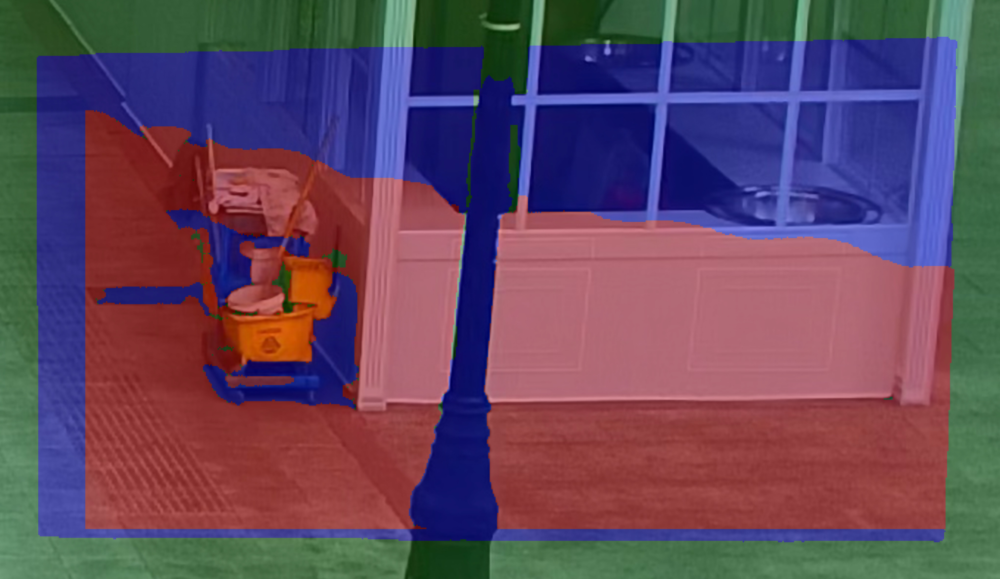 | 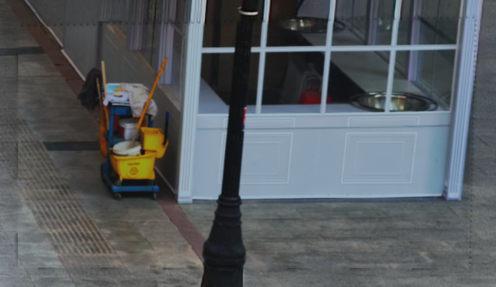 |  |
| [商街人群 cam11 · Frame 6000](../examples/three_region_stitch/selected_1000f/20220806141041707_cam11/manifest.json) | 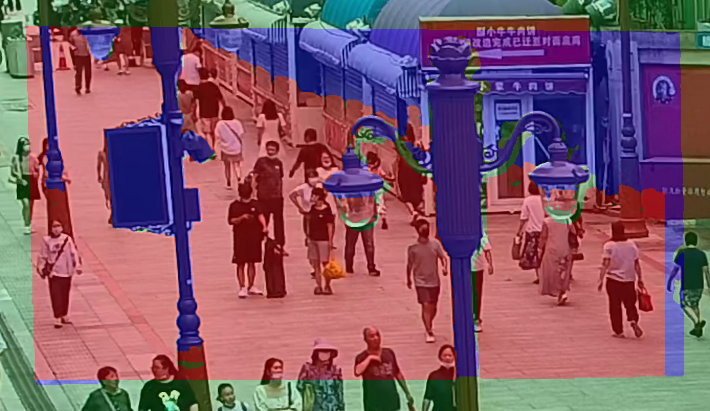 |  |  |
| [商街人群 cam21 · Frame 6000](../examples/three_region_stitch/selected_1000f/20220806141041707_cam21/manifest.json) | 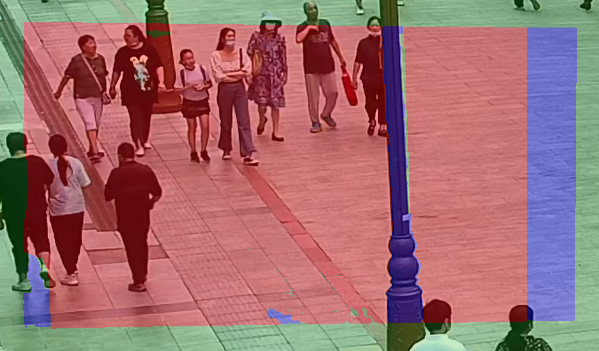 | 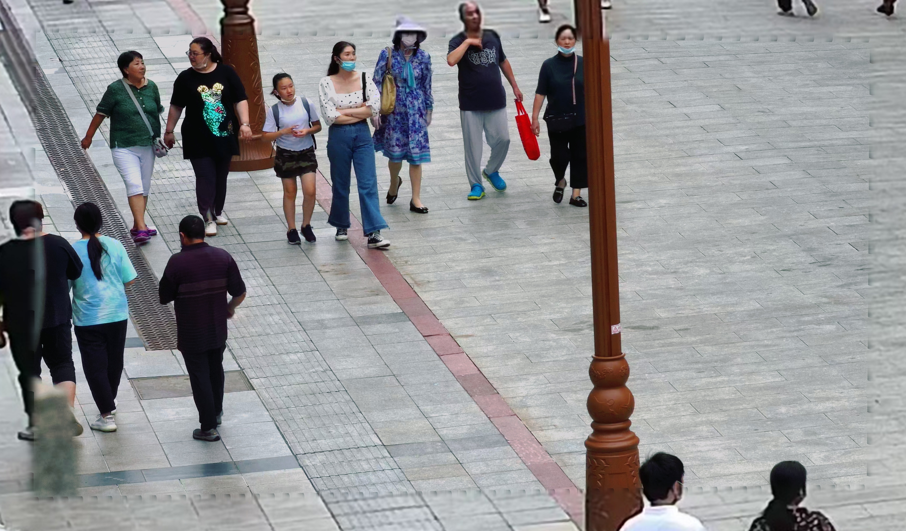 | 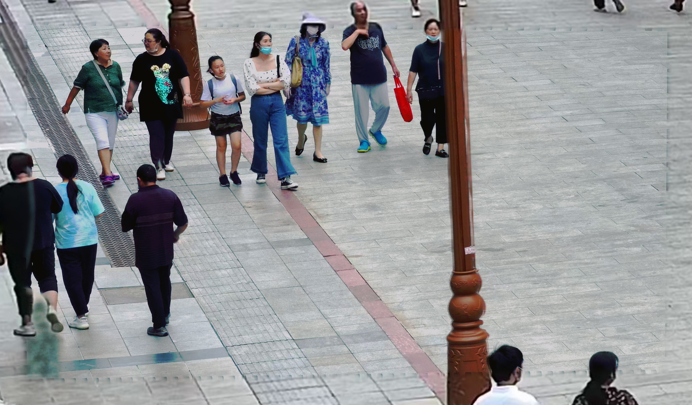 |
| [商街人群 cam31 · Frame 6000](../examples/three_region_stitch/selected_1000f/20220806141041707_cam31/manifest.json) | 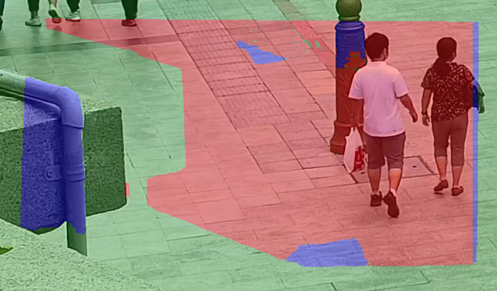 | 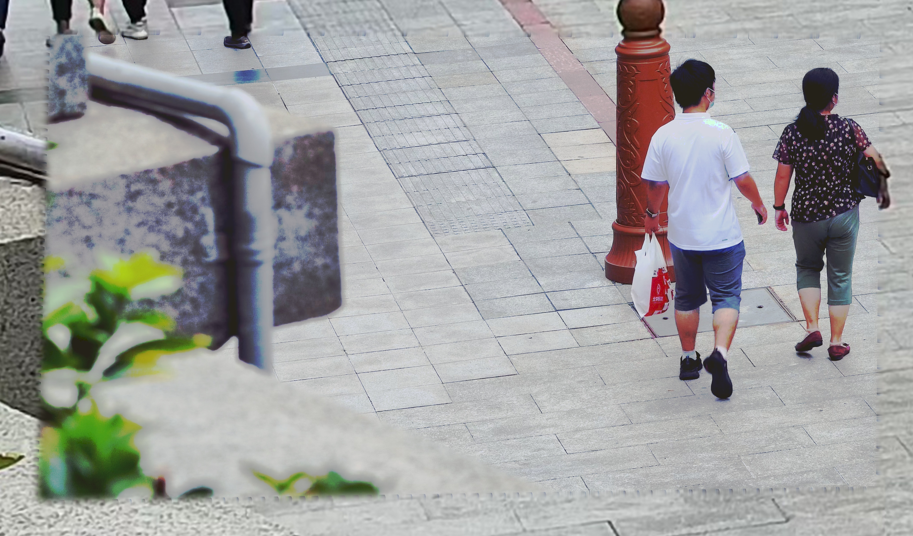 | 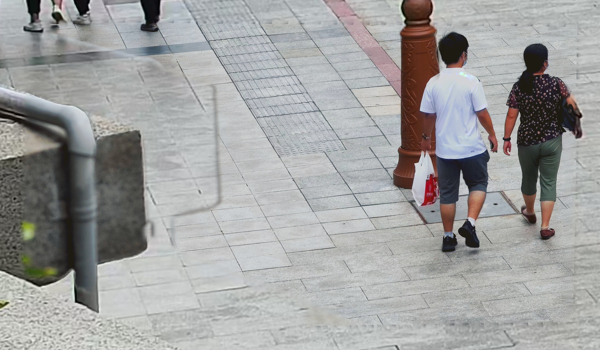 |
| [共享单车道路 · Frame 1349](../examples/three_region_stitch/selected_1000f/20250704164617116_cam15/manifest.json) | 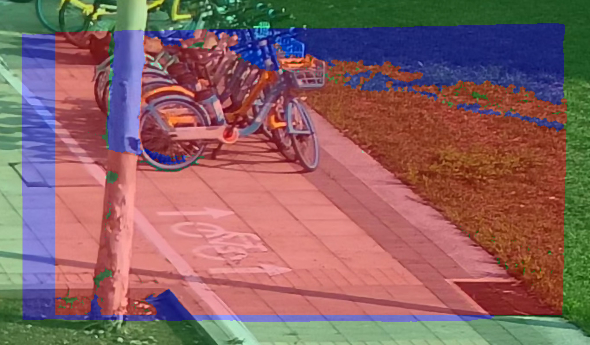 |  | 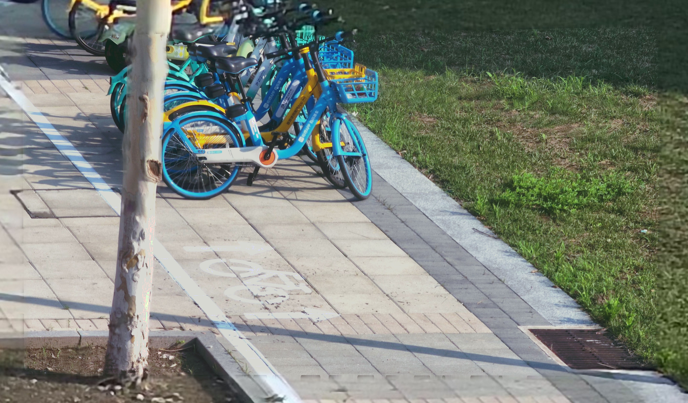 |

每组 `output/three_region/` 还保存完整 x6 Global 画布、Local 附近约 4K 的结果和 `summary.json`。原有三组 200 帧样例作为旧版数据保留。

## 小规模全 ROI 评测

五组样例分别在 Local 投影范围外扩 24 px 的区域内，与同范围的 x6 Global 背景比较，再对 PSNR、SSIM 取算术平均。逐组结果和尺寸见[评测数据](../examples/three_region_stitch/selected_1000f/metrics.json)。这组数值衡量输出与 Global 的相似程度，不代表有真值的拼接质量。

## 数据来源

三分区域样例由 `scripts/export_three_region_sample.py` 从原工程视频和标定数据导出。仓库内输入是裁切后可独立运行的小样例，不需要原工程目录或完整视频。
