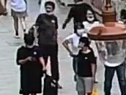
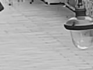
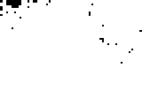

# 视频静态背景提取

[返回项目首页](../README.md)

## 算法与来源

这部分根据原 `MotionMask/script/gmm_method_final_script/` 的 `preprocess.py`、`main_gmm.py` 和 `config.py` 整理。输入一段固定机位视频，输出一张灰度静态背景图。原方法的建模单位是**重叠图像块**：默认将每帧分成 4 × 4 的灰度块，步长 3；同一位置的图像块在时间上形成 16 维样本，再拟合 10 分量的高斯混合模型（GMM）。

每块选权重最大的高斯分量，以其均值作为该位置的背景块；拟合失败时回退到时间均值。把重叠块平均后得到完整背景图。相邻背景块在重叠像素上的 RMSE 小于 4 时，从中心块向外连通，形成辅助的静态区域掩码。因此这里没有逐像素拟合 GMM，也没有调用 `find_peaks`。

本仓库将两阶段脚本整理为一个命令，保留上述选分量、重建与连通规则；临时图像块数据放在运行时目录，结束后自动清理。图像边缘会补一个图像块，以避免原脚本的固定步长在部分尺寸上留下未覆盖像素。代码位于 [`src/video_background_removal/`](../src/video_background_removal/)。

## 输入与输出样例

可运行样例位于 [`20220806141041707_cam100/`](../examples/video_background_removal/20220806141041707_cam100/)。`input/video.mp4` 是商街 Global 相机的 1000 帧中央局部，尺寸 160 × 120；`input/frame_6000.jpg` 只是视频末帧的预览。视频来源和裁剪坐标见 [`sample.json`](../examples/video_background_removal/20220806141041707_cam100/sample.json)。

| 输入视频末帧 | GMM 静态背景 | 静态区域掩码 |
| --- | --- | --- |
|  |  |  |

`background_model_gmm.png` 是实际提取的背景。`static_region_mask.png` 是相邻块连通得到的辅助掩码；`final_result.png` 将掩码叠到背景上供查看，`final_result_masked.png` 仅保留掩码内的背景。`patch_models.npz` 保存每块所选分量的均值、权重和方差；`summary.json` 记录参数与处理帧数。

## 运行

```bash
python -m pip install -e ".[background]"
video-background-removal \
  examples/video_background_removal/20220806141041707_cam100/input/video.mp4 \
  --output-dir examples/video_background_removal/20220806141041707_cam100/output \
  --jobs 4
```

默认处理输入视频的全部帧。可用 `--start-frame`、`--max-frames`、`--frame-step` 控制取帧，用 `--patch-size`、`--stride`、`--components` 和 `--static-threshold` 调整算法。大视频可通过 `--work-dir` 指定有足够空间的临时数据目录。短片段中行人可能长期遮挡背景，导致残影；样例使用 1000 帧而非短片段。

## 样例运行时间

同一段 160 × 120 商街视频、2120 个重叠图像块、10 个高斯分量，使用 4 个并行任务，在 Intel i9-10900X、Python 3.10、scikit-learn 1.7.2 环境中实测如下。时间包含视频解码、拟合和写出；它只对应这个小尺寸样例，不代表 4K 视频的耗时。

| 处理帧数 | 取帧方式 | 墙钟时间 |
| ---: | --- | ---: |
| 100 | 前 100 帧 | 15.84 秒 |
| 500 | 前 500 帧 | 25.60 秒 |
| 500 | 全片每隔 1 帧取 1 帧（`--frame-step 2`） | 32.68 秒 |
| 1000 | 全部 1000 帧 | 88.54 秒 |

前 100 帧生成的背景仍留有明显行人残影；全部 1000 帧的背景见上图。同一全片隔帧采样所得背景与 1000 帧版本的 SSIM 为 0.9818，这只是两张算法输出之间的相似度，不是背景真值评分。GMM 需要对每个空间图像块单独拟合，大图的图像块数会显著增加；可用 `--frame-step` 减少时间采样量，或通过裁剪输入视频控制处理区域。
