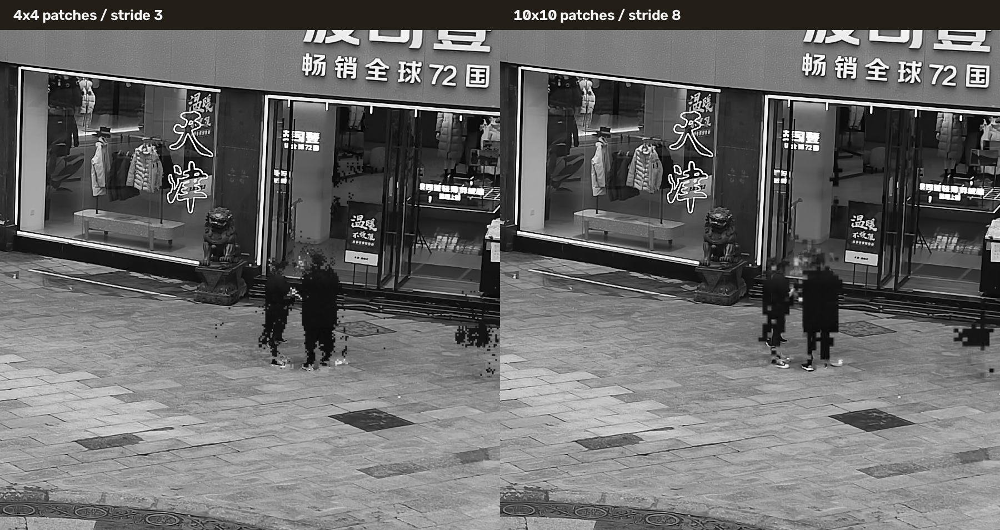

# 视频静态背景提取

[返回项目首页](../README.md)

## 功能与算法流程

输入固定机位视频，输出一张**灰度背景图**和一张辅助的静态连通掩码。实现整理自原工程 `MotionMask/script/gmm_method_final_script/` 的 `preprocess.py`、`main_gmm.py` 和 `config.py`，代码位于 [`src/video_background_removal/`](../src/video_background_removal/)。

1. **建立时序图像块。** 将每帧转为灰度，默认按 4 × 4、步长 3 划分重叠图像块。同一空间位置在不同帧的图像块组成 16 维时序样本。边缘额外补块，确保像素都被覆盖。
2. **估计背景块。** 对每个位置独立拟合 10 分量、对角协方差的 GMM，取**混合权重最大**的分量均值作为背景块；拟合失败才回退到时间均值。这里不是逐像素拟合，也不是逐像素取峰。
3. **重建背景图。** 同一像素可能属于多个背景块，将它们的预测值平均，得到 `background_model_gmm.png`。
4. **生成辅助掩码。** 从图像中心的背景块开始，检查上下左右相邻块的重叠像素；其均方根误差（RMSE）小于默认阈值 3.0 时，将相邻块加入连通区域。把连通块覆盖的像素写入 `static_region_mask.png`。4 × 4、步长 3 时，相邻块只有 1 px 宽的重叠带。

第 4 步**不参与第 2、3 步的背景估计**。掩码描述的是背景块之间能否通过重叠误差连通，不是行人检测或可靠的运动掩膜。即使掩码覆盖率很高，背景图仍可能有人影残留；裁剪还会改变中心起点与边缘图像块，因此裁剪掩码和全图掩码也不一定相同。

## 原始 4K Global 样例

商街 `20220806141041707` 的 Global 原视频为 3840 × 2160。下图展示同一原始画布：左图是参与采样的 Frame 5997，中央是 500 帧估计出的灰度背景，右图是辅助连通掩码。以 Frame 4001 为起点，每隔 4 帧取 1 帧，共覆盖到 Frame 5997；详细参数和来源见[样例清单](../examples/video_background_removal/20220806141041707_cam100/full_global_review/manifest.json)。

| 原始 Global · Frame 5997 | GMM 背景估计 | 辅助静态连通掩码 |
| --- | --- | --- |
|  |  |  |

这次全幅运行得到 921,600 个图像块；使用默认 RMSE 阈值 3.0 后，连通掩码覆盖 89.40% 的像素。背景图在商店门前和远处行人密集处仍有残影；调整这个阈值只改变辅助掩膜，不会改变 GMM 背景估计。原始 3840 × 2160 Global 视频已随样例纳入仓库，使用 Git LFS 存储，路径为 [`input/global_video.mp4`](../examples/video_background_removal/20220806141041707_cam100/full_global_review/input/global_video.mp4)。

首页提供了[视频与掩码叠加的 GIF 预览](../examples/video_background_removal/20220806141041707_cam100/full_global_review/output/static_mask_on_full_video_preview.gif)和[完整 80 秒演示视频](../examples/video_background_removal/20220806141041707_cam100/full_global_review/output/static_mask_on_full_video_4001_6000_960x540.mp4)。演示将基于上述 500 帧估计出的固定静态连通掩码叠加到原视频连续 2000 帧；绿色为掩码保留区域，红色为掩码未覆盖区域。它展示的是掩码位置随原视频播放的效果，不是逐帧运动检测或背景替换结果。

## 可运行的小视频样例

[`20220806141041707_cam100/`](../examples/video_background_removal/20220806141041707_cam100/) 另附真实 Global 视频的 1000 帧、160 × 120 局部，`input/video.mp4` 可直接运行；`input/frame_6000.jpg` 是预览。来源和裁剪坐标见 [`sample.json`](../examples/video_background_removal/20220806141041707_cam100/sample.json)。其 `output/` 保存背景图、连通掩码、叠加预览 `final_result.png`、掩码内背景 `final_result_masked.png`、各块所选 GMM 参数 `patch_models.npz` 和 `summary.json`。叠加预览与掩码图只是诊断输出，实际估计的背景是 `background_model_gmm.png`。

## 运行

```bash
python -m pip install -e ".[background]"
video-background-removal \
  examples/video_background_removal/20220806141041707_cam100/input/video.mp4 \
  --output-dir examples/video_background_removal/20220806141041707_cam100/output \
  --jobs 4
```

默认处理输入视频的全部帧。可用 `--start-frame`、`--max-frames`、`--frame-step` 控制取帧，用 `--patch-size`、`--stride`、`--components` 和 `--static-threshold` 调整算法。大视频可通过 `--work-dir` 指定有足够空间的临时数据目录。短片段中行人可能长期遮挡背景，导致残影；样例使用 1000 帧而非短片段。

下载原始视频后，可用下面的参数复现上面的全幅结果；`--output-dir` 请指向有足够空间的位置。原视频的具体来源及帧号见样例清单。

```bash
video-background-removal examples/video_background_removal/20220806141041707_cam100/full_global_review/input/global_video.mp4 \
  --output-dir /path/to/output \
  --start-frame 4001 --frame-step 4 --max-frames 500 \
  --patch-size 4 --stride 3 --components 10 --jobs 4 \
  --work-dir /path/to/temporary_storage
```

## 样例运行时间

同一段 160 × 120 商街视频、2120 个重叠图像块、10 个高斯分量，使用 4 个并行任务，在 Intel i9-10900X、Python 3.10、scikit-learn 1.7.2 环境中实测如下。时间包含视频解码、拟合和写出；它只对应这个小尺寸样例，不代表 4K 视频的耗时。

| 处理帧数 | 取帧方式 | 墙钟时间 |
| ---: | --- | ---: |
| 100 | 前 100 帧 | 15.84 秒 |
| 500 | 前 500 帧 | 25.60 秒 |
| 500 | 全片每隔 2 帧取 1 帧（`--frame-step 2`） | 32.68 秒 |
| 1000 | 全部 1000 帧 | 88.54 秒 |

原始 4K Global 的 500 帧、每隔 4 帧取样实验使用相同的 4 个并行任务，实测 **7398.03 秒（约 2 小时 03 分）**，临时图像块文件约 6.9 GiB。两组耗时都包含视频解码、GMM 拟合和写出，不能直接按像素数推算其他帧数的耗时。

小样例前 100 帧仍留有明显残影。同一全片隔帧采样所得背景与其 1000 帧版本的 SSIM 为 0.9818，只表示两张算法输出相近，不是背景真值评分。

## 原始 4K 全幅参数对比

使用商街 Global 原视频的同一段 1000 帧，比较两种图像块设置。两组都处理原始 3840 × 2160 画面，从零起始帧索引 4001 开始每隔 2 帧取 1 帧，到 5999 为止；均使用 10 个对角协方差高斯分量和 12 个并行任务。测试环境为 Intel Core i9-10900X、Python 3.10.19、scikit-learn 1.7.2。

| 图像块 / 步长 | 图像块数 | 耗时 | 峰值内存 | 背景观察 |
| --- | ---: | ---: | ---: | --- |
| 4 × 4 / 3 | 921,600 | 5,203.99 秒（约 1 小时 27 分） | 14.37 GiB | 局部细节较细，仍有行人残影 |
| 10 × 10 / 8 | 129,600 | 1,472.56 秒（约 24 分 33 秒） | 12.70 GiB | 约快 3.5 倍，行人附近的残影更块状 |

下图放大同一处店铺前的行人区域，左为 4 × 4，右为 10 × 10。两种设置都保留了动态目标残影；较大的图像块减少了计算量，也使局部残影更粗。默认阈值 3.0 下，辅助掩码覆盖率分别为 89.93% 和 97.29%；该数值描述的是图像块之间的连通范围，不表示背景提取质量。



两种设置的完整背景图与掩码可分别查看：

| 4 × 4 / 步长 3 | 10 × 10 / 步长 8 |
| --- | --- |
| 背景：[PNG](../examples/video_background_removal/20220806141041707_cam100/full_global_review/parameter_comparison/background_4x4_stride3_1000f.png) · 掩码：[PNG](../examples/video_background_removal/20220806141041707_cam100/full_global_review/parameter_comparison/static_mask_4x4_stride3_1000f.png) | 背景：[PNG](../examples/video_background_removal/20220806141041707_cam100/full_global_review/parameter_comparison/background_10x10_stride8_1000f.png) · 掩码：[PNG](../examples/video_background_removal/20220806141041707_cam100/full_global_review/parameter_comparison/static_mask_10x10_stride8_1000f.png) |

可用以下命令复现；输入路径指向仓库内通过 Git LFS 管理的原始 Global 视频。`--static-threshold` 只调节辅助连通掩膜，不参与 GMM 背景估计。

```bash
video-background-removal examples/video_background_removal/20220806141041707_cam100/full_global_review/input/global_video.mp4 \
  --output-dir /path/to/output_4x4 \
  --start-frame 4001 --frame-step 2 --max-frames 1000 \
  --patch-size 4 --stride 3 --components 10 --jobs 12

video-background-removal examples/video_background_removal/20220806141041707_cam100/full_global_review/input/global_video.mp4 \
  --output-dir /path/to/output_10x10 \
  --start-frame 4001 --frame-step 2 --max-frames 1000 \
  --patch-size 10 --stride 8 --components 10 --jobs 12
```

精确配置、输出文件名和计时记录见[参数对比清单](../examples/video_background_removal/20220806141041707_cam100/full_global_review/parameter_comparison/manifest.json)。
